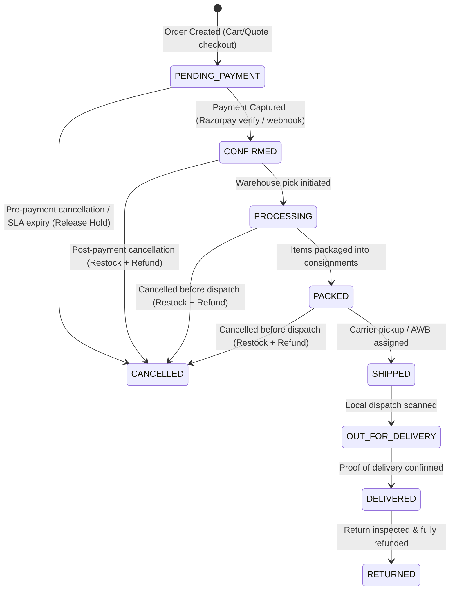

# BASKET Phase 4: Customer Orders, Order Tracking, Cancellations, Returns & Post-Purchase Architecture

## 1. Executive Summary

Phase 4 completes the end-to-end customer commerce journey for the BASKET platform. It delivers full post-purchase capabilities spanning order management, multi-stage shipment tracking, strict state-machine cancellations, granular return request lifecycles with item-level restocking, and a durable notification center with transactional outbox event publishing.

All architectural decisions adhere strictly to BASKET invariants:
- Zero data fabrication (no synthetic carrier API mocks posing as real provider responses, no fake email/SMS network delivery).
- Strict multi-tenant data isolation and anti-IDOR protections.
- Unguessable cryptographically secure guest tokens with SHA-256 hashing.
- Idempotent state transitions and transactional consistency.
- Authoritative PostgreSQL state of truth.

---

## 2. Order Lifecycle State Machine & Validated Transitions

The BASKET order entity supports 9 explicit lifecycle states enforced via check constraints (`chk_order_status`) and domain service transition guards:

### Validated Transitions
1. `PENDING_PAYMENT` -> `CONFIRMED`, `CANCELLED`
2. `CONFIRMED` -> `PROCESSING`, `CANCELLED`
3. `PROCESSING` -> `PACKED`, `CANCELLED`
4. `PACKED` -> `SHIPPED`, `CANCELLED`
5. `SHIPPED` -> `OUT_FOR_DELIVERY`
6. `OUT_FOR_DELIVERY` -> `DELIVERED`
7. `DELIVERED` -> `RETURNED` (upon return inspection & full refund)
8. `CANCELLED` -> Terminal state
9. `RETURNED` -> Terminal state

---

## 3. Order Details & Immutable Audit Trail

Orders maintain complete snapshot integrity:
- **Order Items**: Immutable unit price, tax amount, discount amount, product title, SKU, variant title, and seller metadata captured at checkout.
- **Financial Breakdown**: Items subtotal, delivery fee, taxes, total payable, and payment status.
- **Delivery Address**: Snapshot embedded in order record (`delivery_address_snapshot`), preserving recipient name, street lines, city, state, postal code, and phone at the time of purchase.
- **Status Audit History**: Table `order_status_history` tracks previous state, new state, change reason, actor type (`CUSTOMER`, `SYSTEM`, `ADMIN`), and timestamps.

---

## 4. Carrier Abstraction & Tracking Architecture

BASKET abstracts carrier integrations through the `CarrierProvider` contract:
- **Interface**: `CarrierProvider` defines `validate_tracking_number(tracking_number)` and `get_tracking_url(tracking_number, carrier_name)`.
- **Implementation**: `ManualCarrierProvider` implements deterministic tracking URL generation and format validation for top Indian logistics providers (Delhivery, BlueDart, Ekart, DTDC) and internal carrier networks.
- **Honesty Rule**: Carrier responses never fabricate real-time GPS coordinates or fake API network calls. When external tracking APIs are not configured, clear carrier tracking portal links and consignment histories are surfaced.
- **Partial Shipments**: The `shipments` and `shipment_items` schema supports splitting an order across multiple consignments/carriers with independent tracking numbers and tracking URLs.

---

## 5. Cancellation Engine & Inventory Restocking

### Eligibility Rules
An order can only be cancelled **before it enters the `SHIPPED` state**:
- Permitted states: `PENDING_PAYMENT`, `CONFIRMED`, `PROCESSING`, `PACKED`.
- Forbidden states: `SHIPPED`, `OUT_FOR_DELIVERY`, `DELIVERED`, `CANCELLED`, `RETURNED`.

### Inventory Handling Invariants
1. **Unpaid Orders (`PENDING_PAYMENT`)**: The order only holds an active reservation. Cancellation immediately invokes `ReservationService.release_reservation`, releasing the reserved stock back to available inventory.
2. **Paid Orders (`CONFIRMED`, `PROCESSING`, `PACKED`)**: Inventory was permanently deducted during payment capture. Cancellation invokes `InventoryService.restock_inventory_items`, which locks listings in deterministic ascending ID order to prevent deadlocks and restores `quantity_on_hand`.

### Razorpay Refund Orchestration
When a paid order is cancelled:
- The system queries captured payments for the order via `PaymentRepository`.
- If a captured payment exists, it triggers `PaymentService.create_refund` with the full captured amount and reason `"Order cancelled by customer"`.
- If the payment is still authorized or pending capture, the refund is queued or attempt marked cancelled.

---

## 6. Returns & Inspection Workflow

BASKET enforces a structured return process:
- **Policy Window**: Returns are strictly restricted to orders in `DELIVERED` status within **15 days** of `delivered_at`.
- **Item-Level Granularity**: Customers select specific items and return quantities with validated reason codes (`DEFECTIVE`, `WRONG_ITEM`, `NOT_AS_DESCRIBED`, `SIZE_FIT_ISSUE`, `CHANGED_MIND`).
- **Return Lifecycle**:
  `REQUESTED` -> `APPROVED` / `REJECTED` -> `PICKUP_PENDING` -> `RECEIVED` -> `INSPECTED` -> `REFUND_PENDING` -> `REFUNDED` / `CANCELLED`.
- **Restocking Upon Inspection**: Restocking occurs only when an admin or warehouse inspector confirms the item is in restockable condition (`restock_approved=True`), preventing damaged or wrong returns from re-entering active sellable inventory.
- **Refund Processing**: Approving the return initiates a partial or full refund through `PaymentService.create_refund` matching the approved return items' value.

---

## 7. Durable Notifications & Transactional Outbox

All post-purchase events participate in the PostgreSQL transactional outbox pattern:
- **Outbox Events Published**:
  - `orders.created`
  - `orders.status_updated`
  - `orders.cancelled`
  - `orders.shipment_created`
  - `orders.shipment_updated`
  - `orders.return_requested`
  - `orders.return_updated`
  - `payments.refund_processed`
- **In-App Notification Center**:
  - Table `customer_notifications` records user-visible alerts for orders, shipments, returns, and refunds.
  - REST endpoints allow fetching unread counts, paginated notification lists, and marking notifications as read.
  - Frontend header features an interactive notification bell with dynamic badge counters and unread indicators.
- **Extensible Notification Dispatchers**:
  - `LoggingEmailProvider` and `LoggingSmsProvider` provide clean extension points for SES/SendGrid/Twilio integrations without fabricating network delivery.

---

## 8. Anti-IDOR Security & Guest Access Isolation

1. **Authenticated Requests**:
   - `customer_id` is extracted from verified JWT session cookies.
   - All repository queries filter by `customer_id == current_user.id`.
   - Accessing another user's order raises `HTTP 404 Not Found` (fail-closed, never 403 to prevent enumeration).
2. **Guest Order Protection**:
   - At checkout, guest orders generate a 32-byte URL-safe cryptographic token (`secrets.token_urlsafe(32)`).
   - Only the SHA-256 hash is persisted in `orders.guest_access_token_hash`.
   - Guest lookup endpoint (`POST /api/v1/orders/guest-lookup`) requires both the exact `order_number` and plaintext `access_token`.
   - Hashes are verified using constant-time comparison `hmac.compare_digest`.
   - Plaintext access token is returned exactly once in the checkout response, displayed to the guest with a copy utility, and embedded in deep links (`/orders/[id]?access_token=...`).
