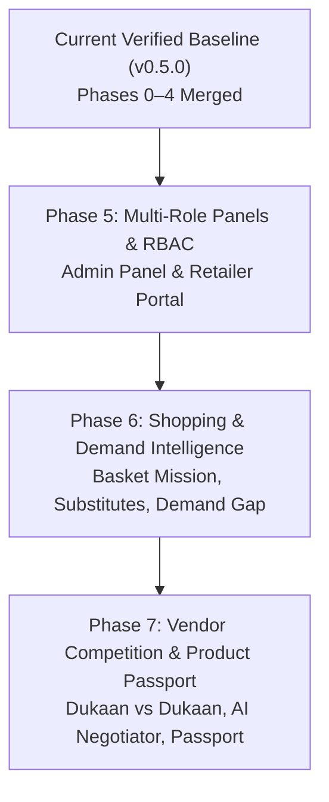

# BASKET — Next Steps & Engineering Roadmap

> **Target Audience:** Engineering Team, Product Managers & Technical Leadership  
> **Status:** Active Roadmap & Prioritized Backlog  
> **Last Updated:** 2026-11-19  
> **Prerequisites Completed:** Phase 0–4 Core Commerce Pipelines Merged & Verified (`0.5.0` Baseline)  

---

## 1. Overview & Current Milestone

With the completion and merging of **Phase 0 through Phase 4** (PR #1 through PR #18), the core commerce infrastructure of BASKET is fully functional, verified by automated tests, and proven end-to-end:
- Product Catalogue, Variants, Categories & Storefront Browsing.
- Persistent Universal Shopping Cart with Guest-to-Customer Merge.
- Server-Authoritative HMAC Pricing Quotes with Line-Item Tax Breakdown.
- All-or-Nothing Atomic Inventory Reservations with Sorted Row Locks.
- Order Creation with Immutable Snapshots and Transactional Outbox Insertion.
- Dual-Mode Razorpay Sandbox Integration with Server-Side Capture Verification.
- Event-Driven Architecture with Aiven Kafka (SASL_SSL) and Outbox Publisher.
- Asynchronous Search Projections with Aiven OpenSearch and Circuit Breaker.
- 7-Stage Order Tracking, Pre-Dispatch Cancellations, Post-Delivery Returns, and In-App Notifications.
- Post-Checkout Order Visibility, `/account` Recent Purchases, and Schema Validation Fixes.

The engineering backlog now transitions to the **Three-Role Multi-Panel Foundation** and **Advanced Shopping Intelligence** defined in [`FEATURE_SPECIFICATION.md`](FEATURE_SPECIFICATION.md).

---

## 2. Roadmap Phases & Prioritized Backlog

---

## 3. Phase 5: Multi-Role Panels & Role-Based Access Control (Immediate Priority)

### Objective
Implement dedicated dashboards, navigation, and backend RBAC authorization for the three core roles: **Admin**, **Retailer**, and **Customer**.

### 5.1 RBAC Enforcement & Identity Extension
- **Backend Middleware & Dependencies:**
  - Create `@require_role(["ADMIN"])` and `@require_role(["RETAILER"])` dependency guards in `backend/app/api/deps.py`.
  - Validate role permissions on every protected endpoint; reject unauthorized roles with HTTP 403 Forbidden (`INSUFFICIENT_PERMISSIONS`).
  - Enforce retailer tenancy: authenticate retailer identity and scope all listing/inventory queries by `retailer_id`.
- **Database Migrations:**
  - Enhance `retailers` table to include business verification status (`PENDING_VERIFICATION`, `VERIFIED`, `SUSPENDED`).
  - Add document upload metadata table (`retailer_verification_documents`).

### 5.2 Admin Panel (`/admin/*`)
- **Dashboard Overview (`/admin`):**
  - High-level marketplace KPIs: total sales volume, active retailers, customer count, order status breakdown.
- **Product & Category Moderation (`/admin/catalogue`):**
  - Add canonical products to the platform catalogue.
  - Category and subcategory taxonomy management.
  - Review and approve retailer-submitted product listings.
- **Platform Deals & Promotions (`/admin/promotions`):**
  - Platform-wide discount campaigns, coupon codes, and promotional banners.
- **Retailer Verification Queue (`/admin/retailers`):**
  - Review retailer KYC documents and approve/reject registrations.
- **Transaction & Dispute Oversight (`/admin/orders`):**
  - Global order monitor, audit logs, and manual intervention controls for disputed orders.

### 5.3 Retailer Portal (`/retailer/*`)
- **Retailer Dashboard (`/retailer`):**
  - Store performance metrics: revenue, order count, top-selling products, low-stock alerts.
- **Store Profile Management (`/retailer/store`):**
  - Store name, logo, description, business hours, and operational status (Open / Closed).
- **Listing & Pricing Management (`/retailer/listings`):**
  - Select canonical products from the platform catalogue.
  - Set retailer SKU, MRP, selling price, and variant prices.
  - Set available stock quantity and reorder thresholds.
- **Order Fulfillment & Consignments (`/retailer/orders`):**
  - View incoming customer orders for their listings.
  - Mark orders as `PROCESSING`, `PACKED`, and `SHIPPED`.
  - Assign logistics carrier codes, tracking numbers, and external consignment URLs.
- **Returns Processing (`/retailer/returns`):**
  - Inspect customer return requests, record condition grades, and approve/reject restock.

---

## 4. Phase 6: Shopping & Demand Intelligence (Medium-Term Priority)

### Objective
Implement the customer-facing shopping intelligence and collective demand aggregation capabilities.

### 6.1 Basket Mission & Intent Memory (`/mission`)
- **Basket Mission AI:**
  - Natural-language shopping goal interface (e.g., "Set up an apartment kitchen for ₹5,000").
  - Constraint-satisfaction basket generation: automatically selects compatible, in-stock products across categories maximizing utility within budget.
- **Basket Intent Memory:**
  - Persists incomplete missions across sessions.
  - Tracks spent money, remaining budget, and pending mission goals.

### 6.2 Basket Substitute Intelligence
- **Like-for-Like Alternative Engine:**
  - If a selected product is out of stock or overpriced, suggests cheaper or better-value alternatives matching exact specifications.
  - Transparently explains recommendation rationale (e.g., "Identical 100% Cotton fabric with higher customer rating, saving ₹350").
- **Price Intelligence:**
  - Historical price trends, lowest recorded price, and discount authenticity indicators.

### 6.3 Demand Gap & Community Buying (`/demand`, `/community`)
- **Demand Gap Radar:**
  - Identifies search queries with zero matching inventory or unmet customer requirements.
  - Allows customers to create or join a structured "Demand Box" for unavailable products.
- **Community Group Buying:**
  - Collective purchasing pools with quantity-based discount tiers (e.g., "Unlock 20% off when 50 units are pre-ordered").

---

## 5. Phase 7: Vendor Competition & Post-Purchase Intelligence (Long-Term Priority)

### Objective
Implement multi-retailer competition and post-purchase ownership documentation.

### 7.1 Dukaan vs Dukaan
- Multi-retailer competitive bidding for customer demand requests.
- Customer-facing comparison matrix: price, delivery speed, seller rating, and warranty terms.

### 7.2 AI Negotiator
- Bounded negotiation agent: customer sets target price and maximum budget.
- AI negotiates against retailer discount parameters within strictly enforced server-side margin floors.

### 7.3 Basket Product Passport (`/account/passport`)
- Post-purchase digital ownership vault: stores tax invoices, warranty certificates, service history, and authorized repair center locations for all delivered items.

### 7.4 Bharat Multilingual
- Full regional language shopping assistance, product translations, and search in Hindi, Tamil, Telugu, Kannada, Marathi, and Bengali.

---

## 6. Definition of Done for Future Phases

Every upcoming phase must satisfy these quality criteria before merging into `integration`:
1. **Separation of Concerns:** Feature specifications must remain separate from implementation audits.
2. **PostgreSQL as Source of Truth:** Authoritative commerce and role data stored in PostgreSQL.
3. **Automated Testing:** Pytest unit/integration tests for every new backend endpoint; frontend tests for every new page/component.
4. **Clean Migrations:** Single Alembic head maintained at all times.
5. **Security & RBAC:** Server-side role and ownership verification on all protected routes; zero hardcoded secrets.
6. **PR Hygiene:** PRs must branch from and target `integration` with green CI checks.
