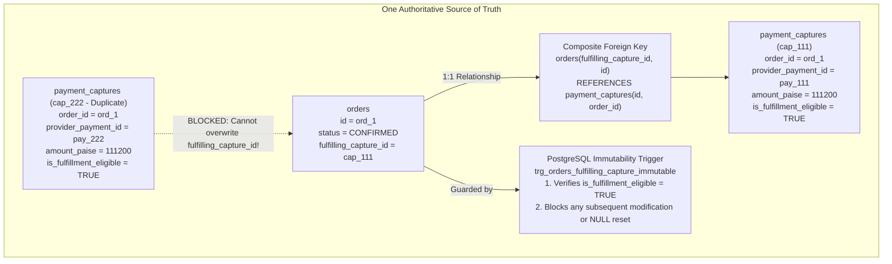
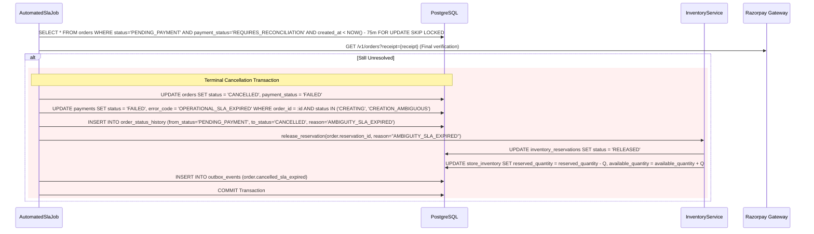
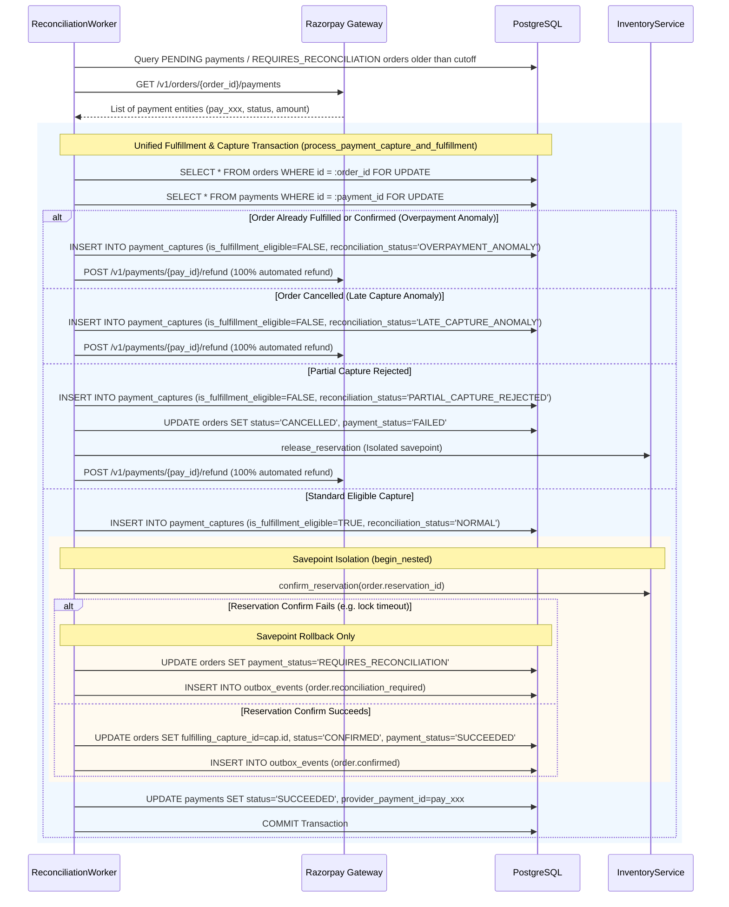

# BASKET — Phase 2F Master Architecture Specification (v3.1.4)
## Razorpay Payments, Capture Ledger, Webhooks, Multi-Refund, Concurrency & Database Invariants

> **Document Version:** 3.1.4 (Final Master Blueprint — Fulfillment Eligibility Durability, Dual INSERT/UPDATE Invariants & Database Invariant Closure)  
> **Status:** APPROVED ARCHITECTURE — READY FOR IMPLEMENTATION APPROVAL  
> **Target Branch for Implementation:** `feature/phase2-payments-razorpay`  
> **Base Branch:** `integration` (Commit: `5163a15`)  
> **Scope:** Complete architectural blueprint for Phase 2F. Read-only specification. No application code, migrations, packages, or git commits are modified during this step.

---

## 1. Executive Summary & System Baseline

### 1.1 Purpose & Architectural Scope
Phase 2F integrates the **Razorpay Payment Gateway (Sandbox)** into BASKET's modular monolith architecture. It establishes an enterprise-grade financial processing boundary that preserves all transactional, inventory, and accounting invariants established across Phases 2A through 2E.

The primary responsibilities of Phase 2F are:
1. **Durable Capture Ledger (`payment_captures`):** Complete relational separation between payment attempts (`payments`), physical capture facts (`payment_captures`), and fulfillment eligibility. Every real provider capture (including unexpected duplicate captures, partial captures, and overpayments) is durably recorded in PostgreSQL. The system **never** loses or rejects recording money received from the gateway.
2. **One Authoritative Source of Truth for Fulfillment:** Elimination of redundant fulfillment flags. An order's fulfillment state is authoritatively governed by a single database relationship: `orders.fulfilling_capture_id UUID UNIQUE REFERENCES payment_captures(id, order_id)`. Enforced on both `INSERT` and `UPDATE` by a composite foreign key and a PostgreSQL immutability trigger (`trg_orders_fulfilling_capture_immutable`), guaranteeing that once confirmed, fulfillment cannot be overwritten, cleared, or stolen by concurrent captures, nor can an order be inserted with an ineligible or foreign capture.
3. **Capture Ledger & Eligibility Immutability:** Core physical capture facts (`provider`, `provider_payment_id`, `order_id`, `payment_id`, `amount_paise`, `currency`, `captured_at`) and historical fulfillment eligibility (`is_fulfillment_eligible`) are protected by a database trigger (`trg_payment_captures_protect_immutable`). ORDINARY `UPDATE` or `DELETE` operations on these columns are strictly prohibited; financial corrections are recorded solely via separate adjustment/audit entities. A capture selected for fulfillment cannot subsequently become ineligible through an ordinary UPDATE.
4. **Terminal 75-Minute Ambiguity SLA & Quarantine Release:** Ambiguous creation attempts enter `CREATION_AMBIGUOUS` with reservations held in `ALLOCATED_TO_ORDER`. After bounded polling, attempts enter a 60-minute Operational Review Quarantine. If unresolved at Minute 75, an automated fail-safe permanently cancels the order, releases reservations exactly once, prevents order re-activation, and routes any subsequent late captures to automated 100% refunds without touching inventory.
5. **Secure Customer Account Anonymization & Unified Retention:** Enforcing `ON DELETE RESTRICT` on `customer_id` across all financial tables (`orders`, `payments`, `payment_captures`, `payment_refunds`). Account deletion immediately revokes active sessions and refresh tokens, sets `is_active = FALSE`, and replaces password with an invalid hash `"!ACCOUNT_ANONYMIZED_REVOKED"`, preserving immutable audit trails without converting customer records into guest records.
6. **Three-Phase Claim-and-Process Webhook Pattern:** Eliminating multi-table lock bloat and inversions by separating webhook claiming via a timed lease (Tx 1), isolated business execution following the universal downward lock hierarchy (Tx 2), and event completion (Tx 3).
7. **Universal Deadlock-Free Lock Hierarchy & Lifecycle Proof:** Strict adherence across all platform workflows to:
   $$\mathbf{orders} \longrightarrow \mathbf{payments} \longrightarrow \mathbf{payment\_captures} \longrightarrow \mathbf{payment\_refunds} \longrightarrow \mathbf{inventory\_reservations} \longrightarrow \mathbf{store\_inventory}$$
   Demonstrating why Phase 2E order creation (which locks quotes and reservations prior to order insertion) is structurally immune to lock inversions with Phase 2F transactions.

---

## 2. Official Razorpay API Verification & Provider Contract

### 2.1 Authoritative Endpoint & Contract Specifications
BASKET communicates with the official Razorpay REST API v1. All requests utilize HTTP Basic Authentication (`Authorization: Basic base64(key_id:key_secret)`), `Content-Type: application/json`, and an explicit User-Agent.

| Operation | Method & URL | Headers | Request Payload (JSON) | Authoritative Response Fields | Official Documentation Reference |
|---|---|---|---|---|---|
| **Create Order** | `POST https://api.razorpay.com/v1/orders` | `Authorization: Basic ...`<br>`Content-Type: application/json` | `{"amount": int, "currency": "INR", "receipt": "str", "notes": {}}` | `id` (`order_xxx`), `amount`, `currency`, `receipt`, `status` (`created`) | [Razorpay Orders API](https://razorpay.com/docs/api/orders/) |
| **Fetch All Orders (By Receipt)** | `GET https://api.razorpay.com/v1/orders?receipt={receipt}` | `Authorization: Basic ...` | Query parameters: `receipt` (str $\le 40$ chars), `count` (default 10) | `entity` (`collection`), `count`, `items` (Array of orders matching `receipt`) | [Razorpay Orders: Fetch All](https://razorpay.com/docs/api/orders/#fetch-all-orders) |
| **Fetch Payment** | `GET https://api.razorpay.com/v1/payments/{payment_id}` | `Authorization: Basic ...` | *None* | `id` (`pay_xxx`), `order_id`, `amount`, `currency`, `status` (`created`, `authorized`, `captured`, `refunded`, `failed`), `method`, `acquirer_data`, `error_code` | [Razorpay Payments API](https://razorpay.com/docs/api/payments/) |
| **Capture Payment** | `POST https://api.razorpay.com/v1/payments/{payment_id}/capture` | `Authorization: Basic ...`<br>`Content-Type: application/json` | `{"amount": int, "currency": "INR"}` | `id`, `amount`, `currency`, `status` (`captured`), `captured_at` | [Razorpay Capture API](https://razorpay.com/docs/api/payments/#capture-a-payment) |
| **Create Refund** | `POST https://api.razorpay.com/v1/payments/{payment_id}/refund` | `Authorization: Basic ...`<br>`X-Refund-Idempotency: {uuid}` | `{"amount": int, "notes": {"refund_id": "uuid"}, "receipt": "str", "speed": "normal"}` | `id` (`rfnd_xxx`), `payment_id`, `amount`, `currency`, `status` (`processed` \| `pending`), `receipt` | [Razorpay Refunds API](https://razorpay.com/docs/api/refunds/) |
| **Fetch Refund** | `GET https://api.razorpay.com/v1/payments/{payment_id}/refunds/{refund_id}` | `Authorization: Basic ...` | *None* | `id`, `payment_id`, `amount`, `status` (`"processed"` \| `"failed"`), `error_code` | [Razorpay Fetch Refund API](https://razorpay.com/docs/api/refunds/#fetch-a-specific-refund) |
| **Webhook Delivery** | Inbound to `POST /api/v1/payments/webhook` | `x-razorpay-signature: str`<br>`x-razorpay-event-id: str` | Raw JSON payload containing event snapshot | Signature matches `hmac_sha256(raw_body_bytes, webhook_secret)` | [Razorpay Webhooks](https://razorpay.com/docs/webhooks/) |

---

## 3. Authoritative Order Fulfillment Invariant (One Source of Truth)

### 3.1 Elimination of Redundant Boolean Flags
In v3.1.2, fulfillment state was tracked both on `payment_captures.is_order_fulfilling` and `orders.fulfilling_capture_id`. Having dual representations created a split-brain vulnerability under high-concurrency races.

Phase 3.1.3 eliminates `is_order_fulfilling` from `payment_captures`.
**`orders.fulfilling_capture_id` is the single, authoritative source of truth for fulfillment.**



### 3.2 Database Enforcement Specification
1. **Unique Constraint on Orders:**
   ```sql
   ALTER TABLE orders ADD COLUMN fulfilling_capture_id UUID UNIQUE;
   ```
   PostgreSQL enforces that at most **one** order can ever reference a given capture.
2. **Composite Same-Order Foreign Key:**
   ```sql
   ALTER TABLE payment_captures ADD CONSTRAINT uq_payment_captures_id_order UNIQUE (id, order_id);

   ALTER TABLE orders ADD CONSTRAINT fk_orders_fulfilling_capture_same_order
   FOREIGN KEY (fulfilling_capture_id, id)
   REFERENCES payment_captures(id, order_id)
   ON DELETE RESTRICT;
   ```
   Guarantees that `orders.fulfilling_capture_id` must belong to the exact same order.
3. **Authoritative Fulfillment Immutability & Eligibility Trigger (Dual INSERT/UPDATE):**
   ```sql
   CREATE OR REPLACE FUNCTION check_order_fulfilling_capture()
   RETURNS TRIGGER AS $$
   DECLARE
       v_eligible BOOLEAN;
   BEGIN
       IF TG_OP = 'INSERT' THEN
           -- On INSERT: if fulfilling_capture_id is provided, validate eligibility and existence
           IF NEW.fulfilling_capture_id IS NOT NULL THEN
               SELECT is_fulfillment_eligible INTO v_eligible
               FROM payment_captures
               WHERE id = NEW.fulfilling_capture_id AND order_id = NEW.id;
               
               IF v_eligible IS NOT TRUE THEN
                   RAISE EXCEPTION 'Illegal fulfillment: capture % does not exist or is not eligible for order % fulfillment', 
                       NEW.fulfilling_capture_id, NEW.id;
               END IF;
           END IF;
       ELSIF TG_OP = 'UPDATE' THEN
           -- On UPDATE: validate state transitions of fulfilling_capture_id
           IF NEW.fulfilling_capture_id IS NOT NULL THEN
               -- 1. Invariant: Once set, fulfilling_capture_id cannot be overwritten/replaced
               IF OLD.fulfilling_capture_id IS NOT NULL AND OLD.fulfilling_capture_id <> NEW.fulfilling_capture_id THEN
                   RAISE EXCEPTION 'Illegal state violation: fulfilling_capture_id is immutable once set (order_id=%, existing=%, attempted=%)', 
                       OLD.id, OLD.fulfilling_capture_id, NEW.fulfilling_capture_id;
               END IF;
               
               -- 2. Invariant: Fulfilling capture MUST be marked fulfillment eligible when first assigned
               IF OLD.fulfilling_capture_id IS NULL THEN
                   SELECT is_fulfillment_eligible INTO v_eligible
                   FROM payment_captures
                   WHERE id = NEW.fulfilling_capture_id AND order_id = NEW.id;
                   
                   IF v_eligible IS NOT TRUE THEN
                       RAISE EXCEPTION 'Illegal fulfillment: capture % does not exist or is not eligible for order % fulfillment', 
                           NEW.fulfilling_capture_id, NEW.id;
                   END IF;
               END IF;
           END IF;

           -- 3. Invariant: fulfilling_capture_id can never be cleared back to NULL
           IF OLD.fulfilling_capture_id IS NOT NULL AND NEW.fulfilling_capture_id IS NULL THEN
               RAISE EXCEPTION 'Illegal state violation: fulfilling_capture_id cannot be cleared once set (order_id=%)', OLD.id;
           END IF;
       END IF;

       RETURN NEW;
   END;
   $$ LANGUAGE plpgsql;

   CREATE TRIGGER trg_orders_fulfilling_capture_immutable
   BEFORE INSERT OR UPDATE ON orders
   FOR EACH ROW
   EXECUTE FUNCTION check_order_fulfilling_capture();
   ```

### 3.3 Trigger Execution Order Relative to Foreign-Key Constraints
In PostgreSQL, constraint enforcement and trigger execution follow a deterministic, layered pipeline:
1. **User `BEFORE INSERT OR UPDATE` Trigger Execution:**
   - `trg_orders_fulfilling_capture_immutable` fires **first**, before any row modification is written or constraint validated.
   - If `NEW.fulfilling_capture_id` is non-null, the trigger queries `payment_captures` for `(id = NEW.fulfilling_capture_id AND order_id = NEW.id)`. If missing or `is_fulfillment_eligible IS NOT TRUE`, the transaction immediately aborts with a descriptive exception.
2. **PostgreSQL System Constraint Checks:**
   - Table `CHECK` constraints (e.g. `chk_order_status`, `chk_order_payment_status`) and `NOT NULL` constraints are evaluated.
3. **Foreign Key Constraint System Triggers:**
   - In PostgreSQL, foreign keys are implemented as internal system triggers (`RI_ConstraintTrigger_c...`) scheduled `AFTER` row operations. By default, they run in `IMMEDIATE` mode at the conclusion of the statement.
   - `fk_orders_fulfilling_capture_same_order` verifies that `(NEW.fulfilling_capture_id, NEW.id)` exists in `payment_captures(id, order_id)`. If someone attempted to insert or update an order with a capture belonging to a different order, the foreign key rejects it with `foreign_key_violation`.
4. **Unique Constraint Verification:**
   - The unique index on `orders(fulfilling_capture_id)` ensures no other order in the database references this capture.
5. **Atomic Rollback on Violation:**
   - If either the user trigger, the composite foreign key, or the unique index raises an error, PostgreSQL automatically aborts the entire transaction, leaving no partial state.

#### Concurrency Resolution Between Competing Captures
If two webhooks or callbacks for distinct captures (`pay_111` and `pay_222`) race to fulfill the order:
- Both lock `orders` sequentially (`FOR UPDATE`).
- Processor 1 sets `orders.fulfilling_capture_id = cap_111.id`, confirms inventory, and commits.
- Processor 2 locks `orders`, inspects `orders.fulfilling_capture_id IS NOT NULL`, recognizes the order is already fulfilled:
  - Processor 2 inserts `cap_222` into `payment_captures` with `reconciliation_status = 'OVERPAYMENT_ANOMALY'`.
  - Processor 2 does NOT touch `orders.fulfilling_capture_id` (trigger would abort it if attempted).
  - Processor 2 triggers an automated 100% refund of `cap_222` without touching stock.

---

## 4. Capture Ledger Immutability & Financial Audit Protection

### 4.1 Physical Capture Fact & Eligibility Protection
Once money is captured by Razorpay and inserted into `payment_captures`, the historical truth of that financial event and its fulfillment eligibility must be permanent. Ordinary application queries or operator mistakes must never alter financial history or invalidate established fulfillment relationships.

```sql
CREATE OR REPLACE FUNCTION protect_payment_capture_immutable_facts()
RETURNS TRIGGER AS $$
BEGIN
    IF TG_OP = 'DELETE' THEN
        RAISE EXCEPTION 'Illegal operation: payment_captures records are permanent financial ledger facts and cannot be deleted (capture_id=%)', OLD.id;
    END IF;

    IF TG_OP = 'UPDATE' THEN
        IF OLD.provider <> NEW.provider OR
           OLD.provider_payment_id <> NEW.provider_payment_id OR
           OLD.order_id <> NEW.order_id OR
           OLD.payment_id <> NEW.payment_id OR
           OLD.amount_paise <> NEW.amount_paise OR
           OLD.currency <> NEW.currency OR
           OLD.captured_at <> NEW.captured_at OR
           OLD.is_fulfillment_eligible <> NEW.is_fulfillment_eligible THEN
            RAISE EXCEPTION 'Illegal operation: core financial facts and fulfillment eligibility in payment_captures are immutable (capture_id=%)', OLD.id;
        END IF;
    END IF;

    RETURN NEW;
END;
$$ LANGUAGE plpgsql;

CREATE TRIGGER trg_payment_captures_protect_immutable
BEFORE UPDATE OR DELETE ON payment_captures
FOR EACH ROW
EXECUTE FUNCTION protect_payment_capture_immutable_facts();
```

### 4.2 Durable Fulfillment Eligibility & Auditable Corrections
- **Protected Core Facts & Eligibility (Never Modifiable, Never Deletable):**
  `id`, `provider`, `provider_payment_id`, `order_id`, `payment_id`, `amount_paise`, `currency`, `captured_at`, `is_fulfillment_eligible`, `created_at`.
- **Eligibility Established at Insertion:**
  A capture's fulfillment eligibility is evaluated and frozen at the moment of insertion into `payment_captures`:
  - Standard successful capture for active order: `is_fulfillment_eligible = TRUE`.
  - Duplicate / overpayment capture: `is_fulfillment_eligible = FALSE`.
  - Partial capture rejected: `is_fulfillment_eligible = FALSE`.
  - Late capture after cancellation / SLA expiry: `is_fulfillment_eligible = FALSE`.
- **Protection Against Invalidation:**
  Because `is_fulfillment_eligible` is immutable, subsequent lifecycle transitions (e.g. `status` transitioning to `'PARTIALLY_REFUNDED'` or `'REFUNDED'`, or `reconciliation_status` transitioning to `'RESOLVED'`) can **never** silently invalidate or downgrade an existing fulfillment relationship in `orders.fulfilling_capture_id`.
- **Auditable Correction Requirement:**
  If a financial discrepancy genuinely requires operational correction, modifying existing capture ledger rows via ordinary `UPDATE` is strictly blocked by `trg_payment_captures_protect_immutable`. Any correction must occur through explicit, auditable compensating transactions (such as inserting a compensating ledger adjustment record or dispatching an official refund) preserving an unbroken audit trail.
- **Allowed Mutable State (Evolves with Business Lifecycle):**
  - `status`: Changes from `'CAPTURED'` $\rightarrow$ `'PARTIALLY_REFUNDED'` $\rightarrow$ `'REFUNDED'`.
  - `reconciliation_status`: Changes from `'OVERPAYMENT_ANOMALY'` $\rightarrow$ `'RESOLVED'`.
  - `acquirer_reference`: Can be updated when delayed bank settlement details arrive.
  - `updated_at`: Updated on legitimate lifecycle transitions.

---

## 5. Terminal Reservation Release After 75-Minute SLA

### 5.1 The 75-Minute Terminal State Machine
Ambiguous payments enter `CREATION_AMBIGUOUS` with reservations held in `ALLOCATED_TO_ORDER`.
- **0 to 5 Minutes:** Bounded polling via `GET /v1/orders?receipt={receipt}`. An empty search result (`count: 0`) is **never** treated as proof of absence.
- **5 to 75 Minutes (60-Minute SLA):** Order is held in Operational Review Quarantine. Inventory remains in `reserved_quantity`. Outbox event `payment.manual_review_required` is emitted.
- **75 Minutes (Automatic Terminal SLA Expiry):**
  If no operator has resolved the ambiguity by Minute 75 (`order.created_at + 75 minutes`), an automated fail-safe escalation job executes:



### 5.2 Post-SLA Invariants & Late-Capture Handling
1. **Permanent Order Cancellation:** Once marked `CANCELLED` with `reason = 'AMBIGUITY_SLA_EXPIRED'`, the order is permanently terminal. No administrative action or customer retry can ever reactivate it.
2. **Prevention of Old Payment Reuse:** All payment attempts for this order are in terminal `FAILED` state.
3. **Prevention of Fresh Initiation:** Any call to `POST /api/v1/orders/{id}/payments` evaluates `if order.status != 'PENDING_PAYMENT': raise 400 ORDER_CANCELLED`.
4. **Subsequent Late Capture Handling:**
   If Razorpay delivers a capture webhook after Minute 75:
   - Worker locks `orders`. Reads `status == 'CANCELLED'`.
   - Inserts capture in `payment_captures`: `is_fulfillment_eligible = FALSE, reconciliation_status = 'LATE_CAPTURE_ANOMALY'`.
   - Stock is **NEVER** deducted. Order is **NEVER** confirmed.
   - Automatically dispatches a 100% refund in `payment_refunds` via `POST /v1/payments/{id}/refund` with `X-Refund-Idempotency`.
   - Outbox event `payment.late_capture_refund_initiated` emitted.

---

## 6. Secure Customer Account Anonymization & Unified Retention

### 6.1 Authentication Flow & Password Verification Safety
In Phase 2A (`IdentityService.login()`):
```python
user = await self.repo.get_user_by_email(normalized_email)
if not user or not user.is_active:
    raise AppException(code="INVALID_CREDENTIALS", status_code=401)
if not verify_password(request.password, user.hashed_password):
    raise AppException(code="INVALID_CREDENTIALS", status_code=401)
```
**Anonymization Rules:**
1. **Immediate Inactivation (`is_active = FALSE`):** Short-circuits login immediately before password verification is ever reached.
2. **Un-hashable Password Marker:** `hashed_password` is replaced with `"!ACCOUNT_ANONYMIZED_REVOKED"`. Bcrypt verification against this string is guaranteed to fail if ever invoked.
3. **Session Revocation:** Invokes `IdentityRepository.revoke_all_sessions_for_user(user.id)`, setting `revoked_at = NOW()` on all rows in `user_sessions`. All active JWT refresh tokens and session cookies are immediately invalidated.

### 6.2 Data Retention & Anonymization Matrix
- `users.email`: Replaced with deterministic anonymized placeholder `f"anonymized_{user.id}@anonymized.basket.local"`, preserving email uniqueness.
- `users.full_name`: Replaced with `"Anonymized Customer"`.
- `users.phone`: Set to `NULL`.
- `addresses`: Active address rows marked `is_deleted = TRUE`.
- `orders`, `payments`, `payment_captures`, `payment_refunds`: All historical financial records retain `customer_id = user.id` with **`ON DELETE RESTRICT`**. Customer records are **never** converted into guest records.

---

## 7. Global Lock Acquisition Matrix Across All Workflows

$$\mathbf{orders} \longrightarrow \mathbf{payments} \longrightarrow \mathbf{payment\_captures} \longrightarrow \mathbf{payment\_refunds} \longrightarrow \mathbf{inventory\_reservations} \longrightarrow \mathbf{store\_inventory}$$

| Workflow / Transaction | Lock 1 | Lock 2 | Lock 3 | Lock 4 | Inversion / Deadlock Proof |
|---|---|---|---|---|---|
| **Phase 2E `create_order`** | `checkout_quotes` | `inventory_reservations` | `orders` (INSERT) | `cart_items` | **Lifecycle Exception Proof:** Order row does not exist prior to this transaction. |
| **Phase 2F Payment Initiation Tx 1** | `orders` (`FOR UPDATE`) | `payments` (`FOR UPDATE`) | — | — | Downward hierarchy. |
| **Phase 2F Webhook Phase 2A (Claim)** | `webhook_events` (SKIP LOCKED) | — | — | — | **Short Tx:** Commits before business locks. |
| **Phase 2F Webhook Phase 2B (Business)**| `orders` (`FOR UPDATE`) | `payments` (`FOR UPDATE`) | `payment_captures` (`FOR UPDATE`) | `inventory_reservations` $\rightarrow$ `store_inventory` | Downward hierarchy. |
| **Phase 2F Webhook Phase 2C (Done)** | `webhook_events` (`WHERE id = :id`) | — | — | — | **Short Tx:** Commits after business Tx 2. |
| **Phase 2F Verify Payment** | `orders` (`FOR UPDATE`) | `payments` (`FOR UPDATE`) | `payment_captures` (`FOR UPDATE`) | `inventory_reservations` $\rightarrow$ `store_inventory` | Downward hierarchy. |
| **Phase 2F Order Expiry / SLA Job** | `orders` (`FOR UPDATE SKIP LOCKED`) | `payments` (`FOR UPDATE`) | `inventory_reservations` (`FOR UPDATE`) | `store_inventory` (`listing_id` ASC) | Enforces `orders` first. Prevents AB-BA deadlocks. |
| **Phase 2F Payment Refund** | `orders` (`FOR UPDATE`) | `payments` (`FOR UPDATE`) | `payment_captures` (`FOR UPDATE`) | `payment_refunds` (INSERT/UPDATE) | Downward hierarchy. |
| **Phase 2F Reconciler** | `orders` (`FOR UPDATE SKIP LOCKED`) | `payments` (`FOR UPDATE`) | `payment_captures` (`FOR UPDATE`) | `inventory_reservations` $\rightarrow$ `store_inventory` | Downward hierarchy. |

### 7.1 Missed-Webhook Payment Recovery Architecture
When a customer completes payment on the gateway but the payment webhook is lost, delayed, or dropped due to network partitions, the background reconciliation worker actively queries Razorpay (`GET /v1/orders/{order_id}/payments`) and reconciles both the payment capture ledger and order fulfillment.



#### Key Invariants & Guarantees:
1. **Unified Fulfillment Logic:** Callback verification (`/payments/verify`), webhook processing (`_handle_payment_captured`), and reconciliation (`reconcile_pending`) execute through the exact same shared helper `process_payment_capture_and_fulfillment()`.
2. **PostgreSQL Savepoint Isolation:** Reservation confirmation (`confirm_reservation()`) is enclosed in `async with session.begin_nested()`. If inventory confirmation aborts (e.g. statement lock timeout), the nested savepoint rolls back only the inventory statement. The outer transaction catches the exception, marks the order `REQUIRES_RECONCILIATION`, records `order_status_history`, emits an outbox event, and cleanly commits the captured payment fact and payment status without transaction rollback.
3. **Repeated Reconciliation & Late Webhook Idempotency:** If reconciliation fulfills an order before the webhook arrives, the subsequent webhook finds `orders.fulfilling_capture_id == capture.id`, acknowledges the existing fulfillment, and commits without duplicate stock deduction or status corruption.
4. **Automated Refund Durability:** External gateway refunds (`dispatch_automated_refund`) record `REFUND_REQUESTED` and commit the capture ledger durably before dispatching to the Razorpay API.

### 7.2 Fail-Closed Production Configuration & Zero-Leak Security
1. **Startup Validation:** In `backend/app/core/config.py`, `@field_validator` validates `RAZORPAY_KEY_ID`, `RAZORPAY_KEY_SECRET`, and `RAZORPAY_WEBHOOK_SECRET`.
2. **Strict Production Enforcement:** When `ENVIRONMENT == "production"`, any missing key or value containing test/mock placeholders (`mock_`, `test_`, `dummy`, `placeholder`, `example`, `your_`) immediately raises `ValueError` and prevents the application from booting.
3. **Secret Masking:** Error messages never print, log, or leak secret strings.

### 7.3 Operational Runbook, Monitoring & Alerting
1. **Scheduled Background Jobs (Cron):**
   - **Pending Reconciliation:** `POST /api/v1/internal/payments/reconcile-pending`
     - Recommended schedule: Every 2 to 5 minutes.
     - Cutoff window: 5 minutes (`pending_cutoff_minutes: 5`).
     - Header: `X-Internal-Service-Key: <INTERNAL_SERVICE_SECRET>`
   - **Operational SLA Escalation:** `POST /api/v1/internal/payments/sla-escalation`
     - Recommended schedule: Every 1 to 5 minutes.
     - Cutoff window: 75 minutes.
     - Header: `X-Internal-Service-Key: <INTERNAL_SERVICE_SECRET>`
2. **Monitoring & Prometheus Metrics:**
   - `reconciled_payments_count`: Count of payments recovered from provider.
   - `reconciled_webhooks_count`: Count of expired webhook leases recovered.
   - `ambiguous_attempts_resolved`: Count of ambiguous attempts resolved against gateway.
3. **Alerting Thresholds:**
   - **P1 Alert:** Orders remaining in `REQUIRES_RECONCILIATION` for > 15 minutes.
   - **P2 Alert:** Elevated count of `PARTIAL_CAPTURE_REJECTED` or `OVERPAYMENT_ANOMALY`.
   - **P2 Alert:** Failed automated refund dispatches requiring manual operator retry.
4. **Manual Recovery Endpoint:**
   - `POST /api/v1/internal/payments/{payment_id}/resolve-ambiguity` with `X-Operator-Id` and `X-Operator-Reason` to manually audit ambiguous attempts exceeding operational review SLAs.

---

## 8. Database Schema Specification (`0008_payments_razorpay_schema.py`)

```sql
-- 1. payments table (Payment Attempts)
CREATE TABLE payments (
    id UUID PRIMARY KEY DEFAULT gen_random_uuid(),
    order_id UUID NOT NULL REFERENCES orders(id) ON DELETE RESTRICT,
    customer_id UUID REFERENCES users(id) ON DELETE RESTRICT,
    guest_token_hash VARCHAR(64),
    provider VARCHAR(32) NOT NULL DEFAULT 'RAZORPAY_SANDBOX',
    provider_order_id VARCHAR(128),
    provider_payment_id VARCHAR(128),            -- Nullable reference to initial payment attempt
    idempotency_key VARCHAR(128) NOT NULL,
    attempt_number INTEGER NOT NULL DEFAULT 1,
    amount_paise BIGINT NOT NULL CHECK (amount_paise >= 0),
    currency VARCHAR(3) NOT NULL DEFAULT 'INR',
    status VARCHAR(32) NOT NULL DEFAULT 'CREATING',
    method VARCHAR(32),
    error_code VARCHAR(64),
    error_description TEXT,
    metadata JSONB NOT NULL DEFAULT '{}',
    created_at TIMESTAMPTZ NOT NULL DEFAULT NOW(),
    updated_at TIMESTAMPTZ NOT NULL DEFAULT NOW(),
    CONSTRAINT chk_payment_ownership CHECK (
        (customer_id IS NOT NULL AND guest_token_hash IS NULL) OR
        (customer_id IS NULL AND guest_token_hash IS NOT NULL)
    ),
    CONSTRAINT chk_payment_status CHECK (
        status IN ('CREATING', 'CREATION_AMBIGUOUS', 'PENDING', 'AUTHORIZED', 'SUCCEEDED', 'FAILED', 'REQUIRES_RECONCILIATION', 'PARTIALLY_REFUNDED', 'REFUNDED')
    ),
    CONSTRAINT uq_payments_order_idempotency UNIQUE (order_id, idempotency_key),
    CONSTRAINT uq_payments_order_attempt UNIQUE (order_id, attempt_number),
    CONSTRAINT uq_payments_id_order UNIQUE (id, order_id)
);

CREATE INDEX ix_payments_provider_order ON payments (provider_order_id);
CREATE INDEX ix_payments_order_created ON payments (order_id, created_at DESC);
CREATE INDEX ix_payments_status ON payments (status);

-- 2. payment_captures table (Durable Capture Ledger)
CREATE TABLE payment_captures (
    id UUID PRIMARY KEY DEFAULT gen_random_uuid(),
    payment_id UUID NOT NULL REFERENCES payments(id) ON DELETE RESTRICT,
    order_id UUID NOT NULL REFERENCES orders(id) ON DELETE RESTRICT,
    provider VARCHAR(32) NOT NULL DEFAULT 'RAZORPAY_SANDBOX',
    provider_payment_id VARCHAR(128) NOT NULL,  -- Unique pay_xxx from provider
    provider_order_id VARCHAR(128),
    amount_paise BIGINT NOT NULL CHECK (amount_paise > 0),
    currency VARCHAR(3) NOT NULL DEFAULT 'INR',
    status VARCHAR(32) NOT NULL DEFAULT 'CAPTURED',
    method VARCHAR(32),
    acquirer_reference VARCHAR(128),
    is_fulfillment_eligible BOOLEAN NOT NULL DEFAULT FALSE,
    reconciliation_status VARCHAR(32) NOT NULL DEFAULT 'NORMAL',
    captured_at TIMESTAMPTZ NOT NULL,
    created_at TIMESTAMPTZ NOT NULL DEFAULT NOW(),
    updated_at TIMESTAMPTZ NOT NULL DEFAULT NOW(),
    CONSTRAINT uq_payment_captures_provider_payment UNIQUE (provider, provider_payment_id),
    CONSTRAINT uq_payment_captures_id_order UNIQUE (id, order_id),
    CONSTRAINT fk_payment_captures_payment_same_order FOREIGN KEY (payment_id, order_id) REFERENCES payments(id, order_id) ON DELETE RESTRICT,
    CONSTRAINT chk_capture_reconciliation_status CHECK (
        reconciliation_status IN ('NORMAL', 'OVERPAYMENT_ANOMALY', 'PARTIAL_CAPTURE_REJECTED', 'LATE_CAPTURE_ANOMALY', 'RESOLVED')
    )
);

CREATE INDEX ix_captures_order ON payment_captures (order_id);
CREATE INDEX ix_captures_payment ON payment_captures (payment_id);
CREATE INDEX ix_captures_reconciliation ON payment_captures (reconciliation_status);

-- Protect Capture Ledger Immutability & Eligibility via Trigger
CREATE OR REPLACE FUNCTION protect_payment_capture_immutable_facts()
RETURNS TRIGGER AS $$
BEGIN
    IF TG_OP = 'DELETE' THEN
        RAISE EXCEPTION 'Illegal operation: payment_captures records are permanent financial ledger facts and cannot be deleted (capture_id=%)', OLD.id;
    END IF;

    IF TG_OP = 'UPDATE' THEN
        IF OLD.provider <> NEW.provider OR
           OLD.provider_payment_id <> NEW.provider_payment_id OR
           OLD.order_id <> NEW.order_id OR
           OLD.payment_id <> NEW.payment_id OR
           OLD.amount_paise <> NEW.amount_paise OR
           OLD.currency <> NEW.currency OR
           OLD.captured_at <> NEW.captured_at OR
           OLD.is_fulfillment_eligible <> NEW.is_fulfillment_eligible THEN
            RAISE EXCEPTION 'Illegal operation: core financial facts and fulfillment eligibility in payment_captures are immutable (capture_id=%)', OLD.id;
        END IF;
    END IF;

    RETURN NEW;
END;
$$ LANGUAGE plpgsql;

CREATE TRIGGER trg_payment_captures_protect_immutable
BEFORE UPDATE OR DELETE ON payment_captures
FOR EACH ROW
EXECUTE FUNCTION protect_payment_capture_immutable_facts();

-- Alter orders table to establish single source of truth for fulfillment
ALTER TABLE orders ADD COLUMN fulfilling_capture_id UUID UNIQUE;
ALTER TABLE orders ADD CONSTRAINT fk_orders_fulfilling_capture_same_order
FOREIGN KEY (fulfilling_capture_id, id)
REFERENCES payment_captures(id, order_id)
ON DELETE RESTRICT;

-- Trigger to guarantee fulfilling_capture_id immutability and eligibility (Dual INSERT/UPDATE)
CREATE OR REPLACE FUNCTION check_order_fulfilling_capture()
RETURNS TRIGGER AS $$
DECLARE
    v_eligible BOOLEAN;
BEGIN
    IF TG_OP = 'INSERT' THEN
        IF NEW.fulfilling_capture_id IS NOT NULL THEN
            SELECT is_fulfillment_eligible INTO v_eligible
            FROM payment_captures
            WHERE id = NEW.fulfilling_capture_id AND order_id = NEW.id;
            
            IF v_eligible IS NOT TRUE THEN
                RAISE EXCEPTION 'Illegal fulfillment: capture % does not exist or is not eligible for order % fulfillment', 
                    NEW.fulfilling_capture_id, NEW.id;
            END IF;
        END IF;
    ELSIF TG_OP = 'UPDATE' THEN
        IF NEW.fulfilling_capture_id IS NOT NULL THEN
            -- Invariant: Once set, fulfilling_capture_id cannot be overwritten/replaced
            IF OLD.fulfilling_capture_id IS NOT NULL AND OLD.fulfilling_capture_id <> NEW.fulfilling_capture_id THEN
                RAISE EXCEPTION 'Illegal state violation: fulfilling_capture_id is immutable once set (order_id=%, existing=%, attempted=%)', 
                    OLD.id, OLD.fulfilling_capture_id, NEW.fulfilling_capture_id;
            END IF;
            
            -- Invariant: Fulfilling capture MUST be marked fulfillment eligible when first assigned
            IF OLD.fulfilling_capture_id IS NULL THEN
                SELECT is_fulfillment_eligible INTO v_eligible
                FROM payment_captures
                WHERE id = NEW.fulfilling_capture_id AND order_id = NEW.id;
                
                IF v_eligible IS NOT TRUE THEN
                    RAISE EXCEPTION 'Illegal fulfillment: capture % does not exist or is not eligible for order % fulfillment', 
                        NEW.fulfilling_capture_id, NEW.id;
                END IF;
            END IF;
        END IF;

        -- Invariant: fulfilling_capture_id can never be cleared back to NULL
        IF OLD.fulfilling_capture_id IS NOT NULL AND NEW.fulfilling_capture_id IS NULL THEN
            RAISE EXCEPTION 'Illegal state violation: fulfilling_capture_id cannot be cleared once set (order_id=%)', OLD.id;
        END IF;
    END IF;

    RETURN NEW;
END;
$$ LANGUAGE plpgsql;

CREATE TRIGGER trg_orders_fulfilling_capture_immutable
BEFORE INSERT OR UPDATE ON orders
FOR EACH ROW
EXECUTE FUNCTION check_order_fulfilling_capture();

-- 3. payment_refunds table (Targets Specific Capture in Ledger)
CREATE TABLE payment_refunds (
    id UUID PRIMARY KEY DEFAULT gen_random_uuid(),
    capture_id UUID NOT NULL REFERENCES payment_captures(id) ON DELETE RESTRICT,
    payment_id UUID NOT NULL REFERENCES payments(id) ON DELETE RESTRICT,
    order_id UUID NOT NULL REFERENCES orders(id) ON DELETE RESTRICT,
    provider_refund_id VARCHAR(128) UNIQUE,
    idempotency_key VARCHAR(128) UNIQUE NOT NULL,
    amount_paise BIGINT NOT NULL CHECK (amount_paise > 0),
    currency VARCHAR(3) NOT NULL DEFAULT 'INR',
    status VARCHAR(32) NOT NULL DEFAULT 'REFUND_REQUESTED',
    reason VARCHAR(255),
    error_code VARCHAR(64),
    error_description TEXT,
    metadata JSONB NOT NULL DEFAULT '{}',
    processed_at TIMESTAMPTZ,
    created_at TIMESTAMPTZ NOT NULL DEFAULT NOW(),
    updated_at TIMESTAMPTZ NOT NULL DEFAULT NOW(),
    CONSTRAINT fk_refunds_capture_same_order FOREIGN KEY (capture_id, order_id) REFERENCES payment_captures(id, order_id) ON DELETE RESTRICT,
    CONSTRAINT fk_refunds_payment_same_order FOREIGN KEY (payment_id, order_id) REFERENCES payments(id, order_id) ON DELETE RESTRICT,
    CONSTRAINT chk_refund_status CHECK (
        status IN ('REFUND_REQUESTED', 'REFUND_PENDING', 'REFUND_PROCESSED', 'REFUND_FAILED')
    )
);

CREATE INDEX ix_refunds_capture ON payment_refunds (capture_id);
CREATE INDEX ix_refunds_order ON payment_refunds (order_id);
CREATE INDEX ix_refunds_status ON payment_refunds (status);

-- 4. webhook_events table (With Lease Tracking)
CREATE TABLE webhook_events (
    id UUID PRIMARY KEY DEFAULT gen_random_uuid(),
    provider VARCHAR(32) NOT NULL DEFAULT 'RAZORPAY',
    provider_event_id VARCHAR(128) NOT NULL,
    event_type VARCHAR(128) NOT NULL,
    payload JSONB NOT NULL,
    status VARCHAR(32) NOT NULL DEFAULT 'PENDING',
    claimed_by VARCHAR(128),
    claim_expires_at TIMESTAMPTZ,
    retry_count INTEGER NOT NULL DEFAULT 0,
    error_message TEXT,
    processed_at TIMESTAMPTZ,
    created_at TIMESTAMPTZ NOT NULL DEFAULT NOW(),
    updated_at TIMESTAMPTZ NOT NULL DEFAULT NOW(),
    CONSTRAINT chk_webhook_status CHECK (
        status IN ('PENDING', 'PROCESSING', 'PROCESSED', 'IGNORED', 'FAILED')
    ),
    CONSTRAINT uq_webhook_provider_event UNIQUE (provider, provider_event_id)
);

CREATE INDEX ix_webhook_claim ON webhook_events (status, claim_expires_at);
CREATE INDEX ix_webhook_created ON webhook_events (created_at);
```

### 8.1 Safe Reversible Downgrade
```python
def downgrade():
    op.execute("DROP TRIGGER IF EXISTS trg_orders_fulfilling_capture_immutable ON orders;")
    op.execute("DROP FUNCTION IF EXISTS check_order_fulfilling_capture();")
    op.execute("DROP TRIGGER IF EXISTS trg_payment_captures_protect_immutable ON payment_captures;")
    op.execute("DROP FUNCTION IF EXISTS protect_payment_capture_immutable_facts();")
    op.drop_table("webhook_events")
    op.drop_table("payment_refunds")
    op.drop_constraint("fk_orders_fulfilling_capture_same_order", "orders", type_="foreignkey")
    op.drop_column("orders", "fulfilling_capture_id")
    op.drop_table("payment_captures")
    op.execute("ALTER TABLE orders DROP CONSTRAINT IF EXISTS chk_order_payment_status;")
    op.execute("ALTER TABLE orders ADD CONSTRAINT chk_order_payment_status CHECK (payment_status IN ('NOT_INITIATED', 'PENDING', 'SUCCEEDED', 'FAILED', 'REQUIRES_RECONCILIATION', 'REFUNDED'));")
    op.drop_table("payments")
```

---

## 9. Requirement Traceability Matrix (Master v3.1.4)

| Requirement ID | Specification Requirement | Master Architecture Section | Database Schema / Trigger | API Endpoint / Client | Planned Pytest Verification |
|---|---|---|---|---|---|
| **V314-01** | One Authoritative Fulfillment Source of Truth | §3.1, §3.2, §3.3 | `orders.fulfilling_capture_id`, `trg_orders_fulfilling_capture_immutable` | PostgreSQL Storage Engine | `test_single_authoritative_fulfilling_capture` |
| **V314-02** | Capture Ledger Fact & Eligibility Immutability | §4.1, §4.2 | `trg_payment_captures_protect_immutable` | PostgreSQL Storage Engine | `test_capture_ledger_facts_and_eligibility_immutable` |
| **V314-03** | Order INSERT with Ineligible Capture Rejected | §3.2, §3.3 | `trg_orders_fulfilling_capture_immutable` (INSERT) | Order Service / SQL | `test_insert_order_with_ineligible_capture_rejected` |
| **V314-04** | Order INSERT with Foreign Order Capture Rejected | §3.2, §3.3 | `fk_orders_fulfilling_capture_same_order`, Trigger | Order Service / SQL | `test_insert_order_with_foreign_capture_rejected` |
| **V314-05** | Selected Capture Eligibility Cannot Be Downgraded | §4.1, §4.2 | `trg_payment_captures_protect_immutable` | PostgreSQL Storage Engine | `test_update_capture_eligibility_rejected` |
| **V314-06** | Fulfillment Reference Cannot Be Replaced or Cleared | §3.2, §3.3 | `trg_orders_fulfilling_capture_immutable` | Order Service / SQL | `test_order_fulfillment_immutable_once_set` |
| **V314-07** | Fulfillment Preserved Across Refunds & Reconciliations | §3.2, §4.2 | Composite FK & Trigger Immutability | Payment / Refund Engine | `test_fulfillment_survives_refund_and_reconciliation` |
| **V314-08** | Concurrent Captures Produce At Most One Fulfiller | §3.2, §7.0 | Row Locks on `orders`, `fulfilling_capture_id UNIQUE` | Webhook vs Callback Workers | `test_concurrent_captures_single_fulfillment_invariant` |
| **V314-09** | Terminal 75m SLA Expiry Cancellation | §5.1, §5.2 | Automated SLA Escalation Job | Internal Escalation Worker | `test_sla_expiry_terminal_cancellation` |
| **V314-10** | SLA Expiry Racing with Webhook Capture | §5.2 | Lock Ordering on `orders` | Webhook Worker vs SLA Job | `test_sla_expiry_race_with_webhook_capture` |
| **V314-11** | Late Capture After SLA Expiry Auto-Refund | §5.2 | `payment_captures`, `reconciliation_status='LATE_CAPTURE_ANOMALY'` | Webhook Worker | `test_post_sla_capture_auto_refund` |
| **V314-12** | All Composite FKs Match Unique Keys | §3.2, §8.0 | `uq_payments_id_order`, `uq_payment_captures_id_order` | PostgreSQL Schema | Schema Inspection / Alembic Check |
| **V314-13** | Account Anonymization & Session Revocation | §6.1, §6.2 | `users.is_active=FALSE`, `users.hashed_password` | Identity Service | `test_account_anonymization_and_revocation` |
| **V314-14** | Missed-Webhook Payment Recovery & Fulfillment | §7.1 | `process_payment_capture_and_fulfillment` | `POST /internal/payments/reconcile-pending` | `test_reconciliation_missed_webhook_recovers_payment_and_fulfills_order` |
| **V314-15** | Repeated Reconciliation Idempotency | §7.1 | Capture unique key & Fulfillment check | Reconciliation Worker | `test_reconciliation_repeated_runs_are_idempotent` |
| **V314-16** | Late Webhook Following Reconciliation Idempotency | §7.1 | Fulfillment source of truth | Webhook Worker | `test_reconciliation_then_late_webhook_idempotency` |
| **V314-17** | Invalid Gateway Payments Handling | §7.1 | Anomaly classification & rejection | Reconciliation Worker | `test_reconciliation_invalid_provider_payments_rejected` |
| **V314-18** | Concurrent Reconciliation & Webhook Race Protection | §7.1 | Order row lock serialization | Concurrency / Database | `test_concurrent_reconciliation_and_webhook_race` |
| **V314-19** | Savepoint Isolation on Inventory Statement Failure | §7.1 | `session.begin_nested()` Savepoint | Reconciliation / Inventory | `test_reconciliation_savepoint_isolates_inventory_failure_and_recovers` |
| **V314-20** | Fail-Closed Production Credential Validation | §7.2 | `@field_validator` in `Settings` | Application Core Config | `test_production_rejects_missing_or_mock_razorpay_credentials` |
