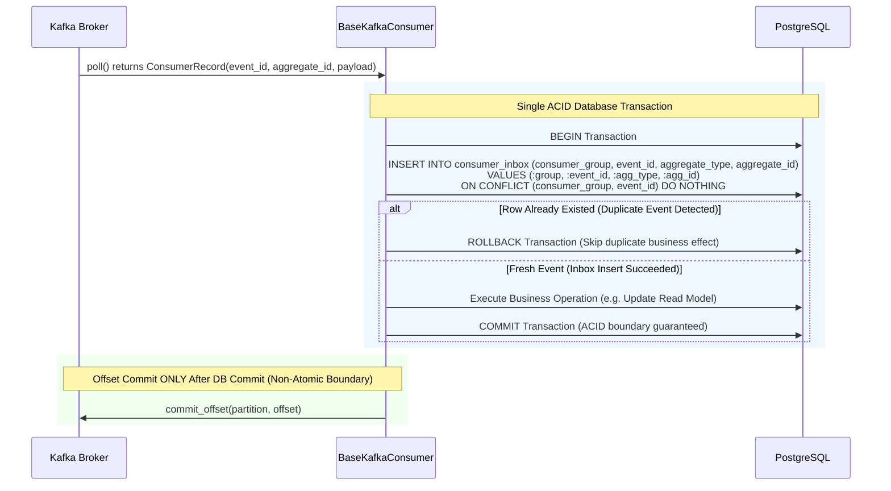
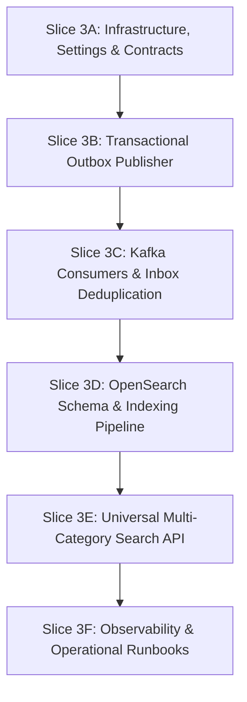

# BASKET — Phase 3 Master Architecture Specification
## Asynchronous Event Streaming (Aiven Kafka), Transactional Outbox, Derived Search Read Model (Aiven OpenSearch), and Universal Multi-Category Search

**Version:** 2.1.0 (Final Architecture Sign-Off & Reliability Closure)
**Status:** ARCHITECTURE SIGNED OFF (Approved for Slice 3A Implementation)
**Baseline Commit:** `6fd7f34` (`integration`)
**Target Delivery:** Phase 3 (Slices 3A through 3F)

---

## Architecture Correction Log

### Version 2.1.0 (Mandatory Sign-Off Clarifications)
1. **PostgreSQL Consumer Commit vs. Offset Commit:**
   - The PostgreSQL database transaction commits strictly **before** initiating the Kafka offset commit.
   - Explicitly documented that the database commit and Kafka offset commit are **not atomic** (no 2PC).
   - Documented inbox deduplication on crash: if a crash occurs after the DB commits but before the offset commits, the re-delivered event is detected as a duplicate via `consumer_inbox`, the duplicate business mutation is skipped, and the offset is committed immediately.
2. **OpenSearch Determinism, Versioning & Deletion:**
   - Defined deterministic document generation: OpenSearch documents are pure, repeatable projections derived strictly from PostgreSQL state.
   - Defined monotonic `aggregate_version` tracking for every aggregate root.
   - Defined deletion and tombstone handling: deactivations/deletions update OpenSearch with higher `aggregate_version` (`is_active: false` or doc deletion via `external_gte`), preventing older out-of-order events from restoring deleted items.
   - Documented replay and duplicate-write behavior: `version_type="external_gte"` cleanly accepts equal versions on replay without error, and rejects lower versions with HTTP 409 Conflict.
3. **Cross-Topic Ordering Boundaries:**
   - Explicitly clarified that Kafka guarantees ordering **strictly within a single partition of an individual topic**. There is **no ordering guarantee across different topics**.
   - Defined consumer reconciliation for delayed events and missing prerequisites: consumers implement non-blocking eventual consistency (pending projection buffering or state-machine terminal locks).
   - Enforced irreversible terminal states: `CONFIRMED` orders can never regress to `PENDING_PAYMENT`; `CANCELLED` orders can never be confirmed.
4. **Privacy & Operational Provider Identifier Classification:**
   - Added formal data classification for payment gateway references (`provider_payment_id`, `provider_refund_id`): classified as **Restricted Operational Identifiers (Level 3 - Pseudonymous/Restricted)**, requiring strict access scoping and a 30-day Kafka retention window.
   - Re-affirmed zero customer PII: `customer_id`, names, emails, phone numbers, and addresses are strictly prohibited across all Kafka event payloads.
5. **Event Timestamps & Monotonic Ordering:**
   - Defined `occurred_at` strictly as the **application UTC timestamp at event object instantiation** (`datetime.now(timezone.utc)`), never as database commit time.
   - Documented that event sequencing and ordering across consumers is strictly governed by **`aggregate_version`**, never by wall-clock timestamps.

### Version 2.0.0 (Distributed Systems & Reliability Correction)
- Outbox `next_attempt_at` durable retry scheduling with bounded exponential backoff and decorrelated jitter.
- Outbox 30s lease expiry protection via bounded batch sizes ($\le 20$) and per-event timeouts (2.0s).
- Enforced lease ownership on updates (`WHERE id IN (...) AND claimed_by = :worker_id`).
- Formally decoupled Strategy A (PostgreSQL-only) and Strategy B (OpenSearch derived read model).
- Kafka offset commitment gated behind DLQ receipt confirmation.
- Evaluated and approved Product-Centric Document Model with embedded retailer listings.
- Added 3-state circuit breaker for OpenSearch search with graceful PostgreSQL fallback.
- Added Pre-Deployment Aiven Validation Checklist.

---

## 1. System Inventory & Audit (Baseline: `6fd7f34`)

```
+---------------------------------------------------------------------------------------------------+
|                                      BASKET MODULAR MONOLITH                                       |
|                                                                                                   |
|   +-------------------+     +--------------------+     +-------------------+                      |
|   |   Orders Module   |     |  Payments Module   |     | Catalogue Module  |                      |
|   +---------+---------+     +---------+----------+     +---------+---------+                      |
|             |                         |                          |                                |
|             +-------------------------+--------------------------+                                |
|                                       | (Atomic ACID Transaction)                                 |
|                                       v                                                           |
|                       +-------------------------------+                                           |
|                       |  PostgreSQL (System of Record)|                                           |
|                       |  - Domain Tables              |                                           |
|                       |  - outbox_events (Durable)    |                                           |
|                       +---------------+---------------+                                           |
+---------------------------------------|-----------------------------------------------------------+
                                        | (Polled via FOR UPDATE SKIP LOCKED where next_attempt_at <= NOW)
                                        v
                       +-------------------------------+
                       |  Outbox Publisher Worker      |
                       |  - Lease Claiming (Ownership) |
                       |  - Exponential Backoff+Jitter |
                       |  - Bounded Batch (10-20 items)|
                       +---------------+---------------+
                                        | (At-Least-Once TLS/SASL Publish)
                                        v
                       +-------------------------------+
                       |   Aiven Apache Kafka Cluster  |
                       |   - Partition Key = Agg ID    |
                       |   - Manual Offset Commits     |
                       +---------------+---------------+
                                        |
                 +----------------------+----------------------+
                 | (Consumer Group:                             | (Consumer Group:
                 |  basket-opensearch-sync)                     |  basket-notifications-analytics)
                 v                                              v
+-------------------------------+              +-------------------------------+
| OpenSearch Ingestion Consumer |              | Future Domain Consumers       |
| - Strategy B (OpenSearch+DB)  |              | - Strategy A (PostgreSQL Only)|
| - External Versioning (GTE)   |              | - Deduplicated Processing     |
| - consumer_inbox Dedup        |              +-------------------------------+
+---------------+---------------+
                |
                v
+-------------------------------+
|   Aiven OpenSearch Cluster    |
|   - basket_products Index     |
|   - Product-Centric Docs      |
+---------------+---------------+
                ^
                | (Read-Only Search Queries with Circuit Breaker)
+---------------+---------------+
| Search API (GET /v1/search)   |
| - Fast OpenSearch Retrieval   |
| - Circuit Breaker Protected   |
| - Graceful SQL Fallback       |
+-------------------------------+
```

### Verified Source Inventory Matrix

| Component / Subsystem | Current State in Source Code | Verification Status | Operational Gap / Missing Capability |
|:---|:---|:---|:---|
| **Identity & Address** | Fully implemented in `modules/identity`. Argon2id hashing, JWT access/refresh rotation, CSRF, address management. | 27/27 tests passing. Verified. | None. Production-ready. |
| **Catalogue & Inventory** | Implemented in `modules/catalogue`. PostgreSQL schema (`products`, `variants`, `listings`, `inventory`). SQL `ilike` search. | 12/12 tests passing. Verified. | Search is unindexed SQL `ilike`; does not scale to high volumes or provide typo-tolerant ranking. |
| **Cart & Pricing** | Implemented in `modules/cart` & `modules/pricing`. Guest/auth cart merge, HSN tax classifications, GST calculation, quotes. | 32/32 tests passing. Verified. | None. Authoritative checkout foundation. |
| **Inventory Reservations** | Implemented in `modules/inventory`. Two-phase 10-minute holds, high-concurrency check constraints, background cleanup. | 24/24 tests passing. Verified. | Inventory changes do not emit outbox events. |
| **Orders & Outbox Schema** | Implemented in `modules/orders`. Unpaid order lifecycle, `outbox_events` table (migration `0007`). | 22/22 tests passing. Verified. | `outbox_events` lacks lease fields (`claimed_by`, `claim_expires_at`, `next_attempt_at`, `correlation_id`). Only `order.created` is emitted. |
| **Payments & Gateways** | Implemented in `modules/payments`. Razorpay sandbox, capture ledger, multi-refund, missed-webhook recovery. | 34/34 tests passing. Verified. | Emits `order.confirmed` & `order.cancelled` to `outbox_events`, but no worker publishes them. |
| **Outbox Publisher** | **Non-existent.** Rows sit in `outbox_events` indefinitely with `status = 'PENDING'`. | Unimplemented. | No publisher process, no lease claiming, no Kafka dispatch. |
| **Kafka Client & Topics** | `config.py` contains environment variables (`KAFKA_BOOTSTRAP_SERVERS`), but **no client library or connection code exists**. | Unimplemented. | Need async Kafka client (`aiokafka`), topic definitions, envelope serializer, and retry/DLQ topology. |
| **Kafka Consumers** | **Non-existent.** | Unimplemented. | Need consumer worker base class, offset commit discipline, and durable deduplication inbox. |
| **OpenSearch Client & Index** | `config.py` contains settings (`OPENSEARCH_URL`), but **no client, mapping, or indexing logic exists**. | Unimplemented. | Need `opensearch-py`, multi-category document mappings, blue/green alias rotation, and bulk reindexer. |
| **Universal Search API** | Only SQL-based `GET /api/v1/products` exists. | Verified in SQL. | Need dedicated `GET /api/v1/search` with typo tolerance, aggregations, and fallback to SQL. |

---

## 2. Transactional Outbox Reliability & Delivery Engine

### 2.1 Outbox Schema Extension (`0009_outbox_lease_and_consumer_inbox`)
```sql
ALTER TABLE outbox_events
    ADD COLUMN claimed_by VARCHAR(128) NULL,
    ADD COLUMN claim_expires_at TIMESTAMPTZ NULL,
    ADD COLUMN next_attempt_at TIMESTAMPTZ NOT NULL DEFAULT NOW(),
    ADD COLUMN correlation_id VARCHAR(128) NULL;

ALTER TABLE outbox_events DROP CONSTRAINT IF EXISTS chk_outbox_status;
ALTER TABLE outbox_events ADD CONSTRAINT chk_outbox_status CHECK (
    status IN ('PENDING', 'PROCESSING', 'PUBLISHED', 'FAILED')
);

CREATE INDEX ix_outbox_lease_poll ON outbox_events (status, next_attempt_at, claim_expires_at)
    WHERE status IN ('PENDING', 'PROCESSING');
```

### 2.2 Bounded Batches, Lease Ownership & Long-Running Protection
1. **Batch Size Capped at 20:** Workers claim at most 20 records (`LIMIT 20`) via `SELECT ... FOR UPDATE SKIP LOCKED`.
2. **Per-Event Send Timeout (2.0s):** Remote publish calls to Kafka have hard 2.0-second timeouts. If the total batch loop exceeds 15 seconds, remaining un-sent records are skipped and left for subsequent cycles, preventing 30-second leases from expiring during execution.
3. **Lease-Scoped Mutation (`WHERE claimed_by = :worker_id`):** When acknowledging published or failed events in PostgreSQL, the query strictly requires `WHERE id IN (:ids) AND claimed_by = :worker_id`. If worker-1 stalls for >30s, worker-2 reclaims the expired row; when worker-1 awakens, its update affects 0 rows, guaranteeing stale workers cannot overwrite legitimate progress.

### 2.3 Bounded Exponential Backoff with Decorrelated Jitter
When an outbox event encounters a transient error, its `next_attempt_at` is scheduled using bounded exponential backoff with full jitter to avoid thundering-herd storms against Kafka or PostgreSQL:

$$T_{backoff} = \min\left(T_{max},\; T_{base} \times 2^{retry\_count} + \text{uniform}(0,\; T_{jitter})\right)$$

- $T_{base} = 1.0\text{ second}$, $T_{max} = 300.0\text{ seconds}$ (5 minutes), $T_{jitter} = 2.0\text{ seconds}$, `MAX_RETRIES` = 10 attempts.

### 2.4 The Acknowledged-Publish / Unacknowledged-DB Crash Proof
```text
1. Worker-1 claims outbox row (status = 'PROCESSING', claimed_by = 'worker-1', expires = T+30s).
2. Worker-1 sends event to Kafka -> Broker writes to log and returns ACK with partition offset.
3. [WORKER-1 CRASHES / OOM KILLED] -> PostgreSQL status update never executes.
4. Wall clock reaches T+30s -> Claim lease expires.
5. Worker-2 polls outbox -> Reclaims the row (status = 'PROCESSING', claimed_by = 'worker-2').
6. Worker-2 re-publishes the event to Kafka -> Broker returns new offset.
7. Worker-2 updates PostgreSQL status to 'PUBLISHED'.
```
- **Publisher Invariant:** At-least-once delivery guaranteed.
- **Consumer Invariant:** Downstream consumers achieve **effective exactly-once** execution:
  - PostgreSQL consumers deduplicate via the `consumer_inbox` table (`ON CONFLICT DO NOTHING`).
  - OpenSearch consumers deduplicate via `version_type="external_gte"`, safely ignoring or reapplying equal versions without state regression.

---

## 3. Consumer & External Side-Effect Correctness

Distributed transactions across PostgreSQL and OpenSearch are physically impossible without two-phase commit (2PC). The architecture explicitly decouples consumer side-effect strategies into two distinct patterns.

### 3.1 Strategy A: PostgreSQL-Only Consumers (e.g. Analytics, Outbox Relays)
1. Begin PostgreSQL transaction.
2. `INSERT INTO consumer_inbox (consumer_group, event_id, aggregate_type, aggregate_id) VALUES (...) ON CONFLICT (consumer_group, event_id) DO NOTHING`.
3. If duplicate detected: rollback transaction and commit Kafka offset.
4. If fresh event: execute business mutation in database and commit database transaction.
5. **Commit Kafka offset strictly AFTER database transaction commits.**



#### Crash Scenario Between DB Commit and Offset Commit (Strategy A):
- If the consumer process crashes after the PostgreSQL transaction commits but before `commit_offset()` completes in Kafka:
- Upon consumer restart, Kafka re-delivers the exact same record.
- The consumer begins a transaction and attempts `INSERT INTO consumer_inbox ... ON CONFLICT DO NOTHING`.
- The insertion affects 0 rows because `(consumer_group, event_id)` already exists in the database.
- The consumer detects the conflict, skips executing any duplicate business logic, rolls back the empty transaction, and immediately calls `commit_offset()`.
- **Guarantee:** Business side effects are executed **effectively exactly once**.

### 3.2 Strategy B: OpenSearch Derived Read-Model Consumers
OpenSearch is an external, eventual-consistency document store. The consumer executes a two-phase idempotent sequence:

```mermaid
sequenceDiagram
    participant KFK as Kafka Broker
    participant CON as OpenSearchConsumer
    participant OS as Aiven OpenSearch
    participant DB as PostgreSQL

    KFK->>CON: poll() returns ConsumerRecord(event_id, aggregate_id, payload, aggregate_version)
    rect rgb(255, 250, 240)
        Note over CON,OS: Step 1: Idempotent External-Versioned Upsert
        CON->>OS: PUT /basket_products/_doc/{product_id}?version={aggregate_version}&version_type=external_gte
        alt Success (200 OK / 201 Created)
            OS-->>CON: Document indexed / updated
        else Version Conflict (409 Conflict)
            Note over CON,OS: Newer document already exists in OpenSearch!
            OS-->>CON: 409 Conflict (Safe no-op; stale event discarded)
        else Engine Failure (5xx / Timeout)
            Note over CON,OS: Indexing Failed -> Do NOT advance offset
            CON->>CON: Raise RetriableException (Pause partition & retry)
        end
    end

    rect rgb(240, 248, 255)
        Note over CON,DB: Step 2: Record Processed Event in DB Inbox
        CON->>DB: BEGIN Transaction
        CON->>DB: INSERT INTO consumer_inbox (consumer_group, event_id, aggregate_type, aggregate_id)<br/>VALUES ('basket-opensearch-sync', :event_id, 'Product', :product_id)<br/>ON CONFLICT (consumer_group, event_id) DO NOTHING
        CON->>DB: COMMIT Transaction
    end

    rect rgb(240, 255, 240)
        Note over CON,KFK: Step 3: Acknowledge Kafka Offset
        CON->>KFK: commit_offset(partition, offset)
    end
```

#### Deterministic Document Generation, Versioning & Deletion Handling:
1. **Deterministic Document Generation:**
   - The OpenSearch document projection is a pure mathematical function of PostgreSQL state: given a `Product` entity and its child `variants`, `listings`, and `store_inventory` records, the document builder outputs a canonical JSON document with identical keys, values, and array orderings.
2. **Aggregate-Version Increments:**
   - Every product event carries `aggregate_version: int`.
   - The `aggregate_version` increments monotonically with each committed transaction modifying the product or its children.
3. **Deletion & Tombstone Handling:**
   - When a product is deactivated or deleted (`is_active = FALSE`), a `product.deleted` event is emitted carrying the next higher `aggregate_version`.
   - The consumer updates OpenSearch by issuing:
     `PUT /basket_products/_doc/{product_id}?version={aggregate_version}&version_type=external_gte`
     with `is_active: false` (or executing `DELETE /basket_products/_doc/{product_id}?version={aggregate_version}&version_type=external_gte`).
   - If an out-of-order older update (e.g. v4) arrives after a deletion (e.g. v5), OpenSearch rejects it with **HTTP 409 Conflict**, preventing deleted items from accidentally reappearing.
4. **Replay and Duplicate-Write Behavior:**
   - Because `external_gte` allows writes where incoming version $\ge$ document version, re-running the same event (v5 after v5) updates the document with the identical state without error.
   - Any older version (v4 after v5) is safely rejected with HTTP 409 Conflict, suppressed by the consumer, and advanced past without regressing the document.

---

## 4. Kafka Offset Management & DLQ Guarantees

- **Manual Offset Commit:** `enable_auto_commit = False` across all consumer groups.
- **Cooperative Sticky Assignor:** Configures `CooperativeStickyAssignor` to minimize partition revocations during consumer scaling.
- **Rebalance Revocation Callback:** In-flight uncommitted batches are aborted so the new partition owner can resume from the last committed offset without partial-batch leaks.
- **DLQ Receipt Gate:** Unrecoverable poison messages are routed to `basket.events.dead-letter`. **The original topic offset is committed only after the broker confirms durable receipt of the dead-letter record.**
- **Poison Message Isolation:** Corrupted JSON or unparseable payloads route to DLQ immediately, preventing partition starvation.

---

## 5. Event Privacy, Data Classification & Canonical Envelope

### 5.1 Data Privacy Classification Matrix

| Data Classification Level | Definition & Criteria | Permitted in Kafka Payload? | Retention & Handling Rules | Examples in BASKET Domain |
|:---|:---|:---:|:---|:---|
| **Level 1: Direct Personal Data** | Directly identifies a human individual. Strictly protected under DPDP/GDPR. | **NEVER** | Blocked at envelope validation. | Customer full name, email, phone number, physical delivery address, billing address, IP address. |
| **Level 2: Sensitive Financial Data** | Payment credentials, auth tokens, secrets. | **NEVER** | Blocked at envelope validation. | Password hashes, JWT secrets, Razorpay API secrets, payment card numbers, bank account numbers. |
| **Level 3: Pseudonymous / Restricted Operational Identifiers** | Operational gateway references and internal pseudonyms. Indirectly linkable via external provider APIs. | **RESTRICTED (Payment Events Only)** | Permitted only in `payment.succeeded` for merchant settlement; strictly omitted from search/catalog; maximum 30-day retention. | `provider_payment_id` (`pay_xxx`), `provider_refund_id` (`rfnd_xxx`), `fulfilling_capture_id`. *Note: `customer_id` is excluded from all Phase 3 events.* |
| **Level 4: Non-Personal Domain Data** | Public catalog attributes, inventory quantities, non-personal entity IDs. | **PERMITTED** | Safe for long-term retention and derivation. | `order_id`, `order_number`, `product_id`, `listing_id`, `retailer_id`, `sku`, `selling_price_paise`, `quantity`, `status`. |

### 5.2 Canonical Event Envelope Definition

```json
{
  "event_id": "a3b2c1d0-1234-4567-89ab-cdef01234567",
  "event_type": "order.confirmed",
  "event_version": 1,
  "aggregate_type": "Order",
  "aggregate_id": "9f8e7d6c-5432-10fe-ba98-76543210fedc",
  "aggregate_version": 2,
  "occurred_at": "2026-11-18T18:45:00.123456Z",
  "correlation_id": "req-98765432-abcd",
  "producer": "basket-backend@0.1.0",
  "payload": {
    "order_id": "9f8e7d6c-5432-10fe-ba98-76543210fedc",
    "order_number": "ORD-20261118-A1B2C3",
    "status": "CONFIRMED",
    "payment_status": "SUCCEEDED",
    "total_payable_paise": 149900,
    "currency": "INR",
    "fulfilling_capture_id": "c1d2e3f4-5678-90ab-cdef-1234567890ab"
  }
}
```

#### Event Timestamp Definition:
`occurred_at` is strictly defined as the **application UTC timestamp at the exact moment of event object instantiation** (`datetime.now(timezone.utc).isoformat()`). It is **never** termed or treated as the database commit timestamp. Event ordering across consumers is strictly governed by **`aggregate_version`**, never by wall-clock timestamps.

---

## 6. Event Ordering, Aggregate Ownership & Domain Boundaries

### 6.1 Intra-Partition vs. Cross-Topic Ordering
- **Partition Ordering Guarantee:** Kafka provides strict total ordering **only within a single partition of an individual topic**.
- **No Cross-Topic Ordering:** Events on `basket.events.orders` and `basket.events.payments` have **no deterministic global ordering guarantee**. Network jitter or consumer polling interleaving may cause a payment event to be read before its corresponding order event.
- **Consumer Behavior for Delayed Events & Missing Prerequisites:**
  - If a consumer on `payments` receives `payment.succeeded` for an `order_id` before the consumer on `orders` has processed `order.created`, the consumer must not block or crash.
  - Consumers implement non-blocking eventual consistency: they buffer pending payment ledger projections or record payment facts against unresolved order references.
  - **Terminal-State Protections:** State machines enforce irreversible terminal transitions. An order in state `CONFIRMED` can never regress to `PENDING_PAYMENT`, even if a delayed `order.created` event is processed late. An order in state `CANCELLED` can never be confirmed.

### 6.2 Aggregate Ownership & Partition Key Mapping

| Event Type | Owning Domain Aggregate Root | Partition Key (`key = ...`) | Kafka Target Topic |
|:---|:---|:---|:---|
| `order.created` | `Order` | `order_id` (UUID) | `basket.events.orders` |
| `order.confirmed` | `Order` | `order_id` (UUID) | `basket.events.orders` |
| `order.cancelled` | `Order` | `order_id` (UUID) | `basket.events.orders` |
| `payment.succeeded` | `Payment` / `Order` | `order_id` (UUID) | `basket.events.payments` |
| `payment.refund_requested` | `Payment` / `Order` | `order_id` (UUID) | `basket.events.payments` |
| `payment.refunded` | `Payment` / `Order` | `order_id` (UUID) | `basket.events.payments` |
| `product.created` | `Product` | `product_id` (UUID) | `basket.events.catalogue` |
| `product.updated` | `Product` | `product_id` (UUID) | `basket.events.catalogue` |
| `product.deleted` | `Product` | `product_id` (UUID) | `basket.events.catalogue` |
| `listing.updated` | `Product` (Parent) | `product_id` (UUID) | `basket.events.catalogue` |
| `inventory.updated` | `Product` (Parent) | `product_id` (UUID) | `basket.events.inventory` |

---

## 7. Product Index Document Design: Product-Centric Model

### Comparison & Approved Recommendation
- **Product-Centric Document Model (Approved):** One document per canonical `Product`, containing an embedded array of active `retailers` listings and computed `min_price_paise` / `max_price_paise`.
  - *Why:* Prevents search result duplication (e.g. searching "Milk" displays 1 card with "From ₹72 at 3 stores" rather than 5 duplicate cards). Brand and category facets remain accurate.
  - *Document Size:* Typically < 4 KB; document update overhead during stock changes is negligible.

### Verified PostgreSQL Source Alignment
Every indexed field is verified against real columns in `backend/app/modules/catalogue/models.py`:
- `Product.name`, `Product.brand`, `Product.slug`, `Product.description` verified on `products`.
- `Category.name`, `Category.slug` verified on `categories`.
- `primary_image_url` verified from `product_images.url WHERE is_primary = TRUE`.
- `rating` verified from `retailers.rating` (Float, default 5.0).
- `min_price_paise`, `max_price_paise` aggregated from `product_listings.selling_price_paise`.
- `is_in_stock` aggregated from `store_inventory.on_hand_quantity - store_inventory.reserved_quantity > 0`.

---

## 8. Search Resilience & PostgreSQL Fallback

- **Circuit Breaker Configuration:**
  - Connect timeout: 200ms; Read timeout: 500ms.
  - 5 consecutive failures trip the circuit breaker to **OPEN**.
  - While OPEN, all queries route immediately to PostgreSQL fallback for 30s without making network calls to OpenSearch.
  - Half-Open probe: 1 request tests recovery after 30s.
- **Database Traffic Protection:**
  - Fallback queries set `"engine": "postgres_fallback"`.
  - Heavy multi-dimensional facet calculations are skipped (`facets: null`) to prevent PostgreSQL CPU exhaustion.
  - Page limit is capped at 20 (`limit <= 20`).

---

## 9. Aiven Infrastructure Validation Checklist & Client Comparison

All partition counts (3), replicas (2), and retention are provisional baselines until verified:
```
[ ] 1. Kafka Service Tier Verification:
       - Run: aiven service get <service-name> --json
       - Verify max partition limit and storage quota.
       - Aiven Startup: Replication Factor MUST be 1 (single-node broker).
       - Aiven Business/Premium: Replication Factor 2 or 3 supported.

[ ] 2. Kafka TLS & Authentication Verification:
       - Verify CA Certificate (ca.pem), Access Certificate (service.cert), and Access Key (service.key).
       - Validate certificate expiration (alert if < 30 days).
       - Verify SASL_SSL user credentials and SCRAM-SHA-256 ACL permissions.

[ ] 3. OpenSearch Service Tier Verification:
       - Run: curl -k -u <user>:<pass> https://<opensearch-host>:<port>/_cluster/health
       - Confirm cluster status is 'green' or 'yellow'.
       - Verify storage headroom >= 20% free disk space.
```

### Client Evaluation: `aiokafka` vs. `confluent-kafka`
- `aiokafka`: Pure Python asyncio native client. Integrates seamlessly with FastAPI's event loop, zero native C toolchain requirements, small container image footprint, full SASL/SCRAM and TLS support.
- `confluent-kafka`: C wrapper around `librdkafka`. High throughput, but requires compilation toolchains in containers and synchronous thread executors.
- **Evidence-Based Decision:** Retain **`aiokafka>=0.11.0`** as the primary recommendation.

---

## 10. Implementation Slices & Acceptance Criteria



### Slice 3A — Infrastructure, Settings & Event Contracts (Current Active Slice)
- **Scope:** Dependency `aiokafka>=0.11.0`, Aiven settings validation, `EventEnvelope` model with strict Level 1/Level 2 PII validation, `MockKafkaProducer` for local testing.
- **Acceptance Criteria:** Envelope tests pass; mock producer buffers events without live credentials; PII fields fail closed; migration head unchanged.

### Slices 3B Through 3F (Future Slices — Out of Current Implementation Scope)
- Slice 3B: Transactional outbox publisher with lease management and migration `0009`.
- Slice 3C: Reusable Kafka consumer engine with `consumer_inbox` deduplication.
- Slice 3D: OpenSearch index mapping and incremental indexing consumer.
- Slice 3E: Universal search API with circuit breaker and SQL fallback.
- Slice 3F: Prometheus observability and operational CLI runbooks.
