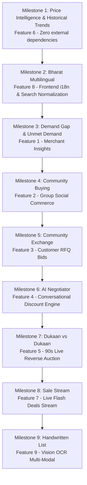

# BASKET — Phase 3 Feature Tracker & Implementation Roadmap

> **Document Version:** 2.0.0  
> **Source Specification:** `docs/product/ONLINE_SHOPPING_FEATURES.md`  
> **Target Audience:** Engineering Leads, System Architects, Claude Development Team  
> **Last Updated:** 2026-11-20  

---

## 1. Executive Summary

This tracker documents the 9 approved **Phase 3 advanced marketplace capabilities** for BASKET. These features build upon the foundation established in Phase 1 (Core Multi-Retailer Marketplace) and Phase 2 (Basket Customer Intelligence: 2A Mission Planner, 2B Substitute Intelligence, 2C Intent Memory, and 2D Product Passport).

### 1.1 Phase 3 Feature Status Matrix

| Feature | Spec Ref | Category | Current Code Status | Target Release |
| :--- | :---: | :--- | :---: | :---: |
| **1. Demand Gap & Unmet Demand Aggregation** | §1.5, §2.9, §3.5 | Merchant Intelligence | Planned / 0% Built | Phase 3A |
| **2. Basket Community Buying (Group Purchasing)**| §1.5, §2.8, §3.6 | Social Commerce | Planned / 0% Built | Phase 3B |
| **3. Basket Community Exchange (Customer RFQs)** | §1.5, §2.8, §3.7 | Dynamic Sourcing | Planned / 0% Built | Phase 3C |
| **4. AI Negotiator (Automated Deal Negotiation)** | §1.6, §2.8, §3.8 | Conversational Commerce| Planned / 0% Built | Phase 3D |
| **5. Dukaan vs Dukaan (Multi-Retailer Bidding)** | §1.6, §2.8, §3.9 | Reverse Auction | Planned / 0% Built | Phase 3E |
| **6. Basket Price Intelligence & Discount History** | §1.7, §2.3, §3.10| Consumer Protection | Planned / 0% Built | Phase 3F |
| **7. Sale Stream (Real-Time Flash Deals Feed)** | §1.2, §2.4, §3.12| Live Engagement | Planned / 0% Built | Phase 3G |
| **8. Bharat Multilingual (Regional Languages)** | §1.10, §3.13 | Inclusivity / Localization| Planned / 0% Built | Phase 3H |
| **9. Handwritten List to Basket (Vision OCR)** | §3.14 | Smart Onboarding | Planned / 0% Built | Phase 3I (Optional) |

> [!IMPORTANT]
> **Explicit Architectural Scope Boundary:**  
> The specification previously mentioned "Sale Stream Rewind". This feature has been **permanently cancelled and removed** from the product requirements. Claude must NOT implement Sale Stream Rewind.

---

## 2. In-Depth Feature Specifications & Technical Blueprints

---

### Feature 1: Demand Gap & Unmet Demand Aggregation
- **Spec Ref:** §1.5, §2.9, §3.5
- **Problem Statement:** Customers frequently search for out-of-stock items, unlisted regional specialties, or unserviceable pincodes. Today, these result in dead ends, leaving retailers unaware of unmet localized demand.
- **Solution:** Detect search zero-results, out-of-stock clicks, and explicit "Notify Me When Available" requests. Aggregate them into geospatial and category "Demand Pools" that alert verified retailers to supply opportunities.
- **Required Database Schema (`0021_demand_gap.py`):**
  - `demand_signals`: `id` (UUID), `user_id` (nullable), `query_text`, `category_id`, `pincode`, `signal_type` (`ZERO_SEARCH`, `OUT_OF_STOCK`, `WISHLIST`), `created_at`.
  - `demand_pools`: `id` (UUID), `normalized_product_name`, `category_id`, `pincode`, `total_demand_count`, `unique_users_count`, `status` (`OPEN`, `FULFILLED`, `EXPIRED`).
- **Required Backend Endpoints:**
  - `POST /api/v1/demand/signal` (Public / Customer: Log unmet demand signal)
  - `GET /api/v1/retailer/demand-gaps` (Retailer: Browse unmet demand in service pincodes)
  - `POST /api/v1/retailer/demand-gaps/{id}/fulfill` (Retailer: Commit to stocking demand pool)
- **Required Frontend Views:**
  - Customer: "Request Product / Notify Local Retailers" modal on zero-result search and OOS product pages.
  - Retailer: `/retailer/demand-gaps` dashboard with demand heatmaps and stock request fulfillment buttons.

---

### Feature 2: Basket Community Buying (Group Purchasing)
- **Spec Ref:** §1.5, §2.8, §3.6
- **Problem Statement:** Indian consumers, apartment societies, and small businesses want bulk wholesale pricing without individually purchasing industrial quantities.
- **Solution:** Time-limited group buying pools where customers join together to unlock tiered volume discounts on staple groceries, electronics, and lifestyle goods.
- **Required Database Schema (`0022_community_buying.py`):**
  - `group_buy_campaigns`: `id` (UUID), `listing_id`, `min_participants`, `max_participants`, `current_participants`, `discount_percent`, `expires_at`, `status` (`OPEN`, `SUCCESSFUL`, `FAILED`).
  - `group_buy_members`: `id` (UUID), `campaign_id`, `user_id`, `quantity`, `order_id` (nullable until campaign success), `joined_at`.
- **Required Backend Endpoints:**
  - `GET /api/v1/community-buying/campaigns` (Public: Browse active group pools)
  - `POST /api/v1/community-buying/campaigns/{id}/join` (Customer: Pre-authorize card and join pool)
  - `GET /api/v1/community-buying/campaigns/{id}/share` (Customer: Generate WhatsApp/SMS referral link)
- **Required Frontend Views:**
  - Customer: `/community-buying` discovery page with progress bars ("5 more people needed to unlock 25% off") and live countdown timers.

---

### Feature 3: Basket Community Exchange (Customer RFQs)
- **Spec Ref:** §1.5, §2.8, §3.7
- **Problem Statement:** Customers seeking bulk orders, event catering supplies, or rare multi-item bundles must manually call dozens of physical retailers.
- **Solution:** Customers submit an unfulfilled basket RFQ (Request for Quotation). Local retailers receive the request and bid their best bundle prices and delivery timelines.
- **Required Database Schema (`0023_community_exchange.py`):**
  - `exchange_requests`: `id` (UUID), `user_id`, `delivery_pincode`, `budget_limit`, `items_manifest` (JSONB), `status` (`BIDDING_OPEN`, `AWARDED`, `EXPIRED`).
  - `exchange_bids`: `id` (UUID), `request_id`, `retailer_id`, `bid_amount`, `estimated_delivery_hours`, `notes`, `status` (`SUBMITTED`, `ACCEPTED`, `REJECTED`).
- **Required Backend Endpoints:**
  - `POST /api/v1/exchange/requests` (Customer: Create custom RFQ basket)
  - `GET /api/v1/retailer/exchange/requests` (Retailer: View open RFQs in serviceable radius)
  - `POST /api/v1/retailer/exchange/requests/{id}/bids` (Retailer: Submit bundle price bid)
  - `POST /api/v1/exchange/requests/{id}/accept-bid` (Customer: Accept bid and convert to checkout order)
- **Required Frontend Views:**
  - Customer: `/exchange/new` bundle builder and `/exchange/my-requests` bid comparison screen.
  - Retailer: `/retailer/exchange` bidding portal with margin calculator.

---

### Feature 4: AI Negotiator (Automated Deal Negotiation)
- **Spec Ref:** §1.6, §2.8, §3.8
- **Problem Statement:** Traditional e-commerce uses static prices. In Indian commerce, negotiation is a cultural standard for high-ticket electronics, fashion bundles, and monthly grocery baskets.
- **Solution:** An AI negotiation assistant acting on behalf of customers against retailer-configured discount rule engines.
- **Required Database Schema (`0024_ai_negotiator.py`):**
  - `retailer_negotiation_rules`: `id` (UUID), `retailer_id`, `listing_id` (nullable for storewide), `min_floor_price`, `max_auto_discount_percent`, `bundle_quantity_threshold`.
  - `negotiation_sessions`: `id` (UUID), `user_id`, `cart_id`, `current_round`, `max_rounds` (default: 3), `proposed_price`, `final_accepted_price`, `status` (`IN_PROGRESS`, `ACCEPTED`, `REJECTED`).
- **Required Backend Endpoints:**
  - `POST /api/v1/negotiate/start` (Customer: Initiate negotiation session on active cart)
  - `POST /api/v1/negotiate/counter-offer` (Customer: Submit counter-offer to AI engine)
  - `POST /api/v1/negotiate/accept` (Customer: Lock negotiated price into an HMAC quote)
- **Required Frontend Views:**
  - Customer: Interactive chat sheet / drawer in cart with AI agent proposing bundle discounts and concessions in real-time.

---

### Feature 5: Dukaan vs Dukaan (Multi-Retailer Reverse Auction)
- **Spec Ref:** §1.6, §2.8, §3.9
- **Problem Statement:** When multiple local kiranas stock the exact same items in a customer's basket, the customer doesn't know who can fulfill the complete order fastest and cheapest.
- **Solution:** A 90-second live reverse auction where nearby shops bid to fulfill the customer's entire basket with lower prices or faster 15-minute delivery.
- **Required Database Schema (`0025_dukaan_vs_dukaan.py`):**
  - `basket_auctions`: `id` (UUID), `user_id`, `cart_snapshot` (JSONB), `pincode`, `duration_seconds` (90s), `status` (`ACTIVE`, `COMPLETED`, `CANCELLED`).
  - `basket_auction_bids`: `id` (UUID), `auction_id`, `retailer_id`, `bid_price`, `delivery_eta_minutes`, `created_at`.
- **Required Backend Endpoints:**
  - `POST /api/v1/auctions/start` (Customer: Trigger 90-second reverse auction)
  - `GET /api/v1/auctions/{id}/live` (Customer: SSE / WebSocket endpoint for live incoming bids)
  - `POST /api/v1/retailer/auctions/{id}/bid` (Retailer: Submit instant competitive bid)
- **Required Frontend Views:**
  - Customer: High-energy countdown ticker with live animated retailer cards dropping prices in real-time.

---

### Feature 6: Basket Price Intelligence & Historical Trends
- **Spec Ref:** §1.7, §2.3, §3.10
- **Problem Statement:** E-commerce platforms often inflate MRPs right before sales to simulate fake discounts.
- **Solution:** Verifiable 90-day price history graphs on Product Detail Pages, tracking lowest price ever, average price, inflation rates, and genuine discount verification badges.
- **Required Database Schema (`0026_price_intelligence.py`):**
  - `price_history_ticks`: `id` (UUID), `listing_id`, `selling_price`, `mrp`, `recorded_date` (Daily snapshot).
  - Materialized view or rolling aggregation table: `listing_price_metrics` (`lowest_price_90d`, `highest_price_90d`, `avg_price_30d`, `genuine_discount_badge`).
- **Required Backend Endpoints:**
  - `GET /api/v1/price-intelligence/listings/{id}` (Public: 90-day price history and discount authenticity score)
- **Required Frontend Views:**
  - Customer: Interactive KaTeX/SVG or lightweight line chart on Product Detail Page showing "Lowest price in 60 days: ₹399".

---

### Feature 7: Sale Stream (Real-Time Flash Deals Feed)
- **Spec Ref:** §1.2, §2.4, §3.12
- **Problem Statement:** Traditional daily deal pages are static, leading to missed flash sales and low engagement.
- **Solution:** A TikTok/Instagram-style live stream feed of real-time price drops, limited flash sales, and live order activity from nearby shops.
- **Required Database Schema (`0027_sale_stream.py`):**
  - `sale_stream_events`: `id` (UUID), `event_type` (`PRICE_DROP`, `FLASH_DEAL`, `HOT_SELLER`), `listing_id`, `old_price`, `flash_price`, `stock_remaining`, `expires_at`.
- **Required Backend Endpoints:**
  - `GET /api/v1/sale-stream/live` (Public: Server-Sent Events or polled real-time stream of live drops)
- **Required Frontend Views:**
  - Customer: `/sale-stream` full-height scrollable feed with countdown rings, stock meters ("Only 4 left"), and one-click quick add.

---

### Feature 8: Bharat Multilingual (Regional Indian Languages)
- **Spec Ref:** §1.10, §3.13
- **Problem Statement:** Over 80% of Indian internet users prefer interacting in their mother tongue (Hindi, Tamil, Telugu, Kannada, Bengali, Marathi, Gujarati).
- **Solution:** Full localized UI strings, bilingual search engine query translation, and voice-assisted product queries.
- **Technical Architecture:**
  - Next.js Internationalization (i18n / `next-intl`) with translation dictionaries in `frontend/locales/{lang}.json`.
  - Backend search query transliteration / translation pre-processor using Indic NLP dictionaries.
- **Supported Languages:**
  - English (`en`), Hindi (`hi`), Tamil (`ta`), Telugu (`te`), Kannada (`kn`), Bengali (`bn`), Marathi (`mr`), Gujarati (`gu`).

---

### Feature 9: Handwritten List to Basket (Vision OCR - Optional)
- **Spec Ref:** §3.14
- **Problem Statement:** Customers write weekly grocery lists on physical paper in mixed English and vernacular scripts (e.g. "1kg Aashirvaad Atta, 500g Amul Butter, Dettol soap 3pc").
- **Solution:** Customer uploads a photo of their handwritten paper list. A multi-modal vision processor parses the items, finds matching products in local inventory, and generates a ready-to-order cart.
- **Required Backend Endpoints:**
  - `POST /api/v1/vision/parse-list` (Customer: Upload photo, returns parsed item array)
  - `POST /api/v1/vision/build-cart` (Customer: Match parsed items to listings and add to cart)
- **Required Frontend Views:**
  - Customer: Camera capture / photo upload screen with item extraction review table.

---

## 3. Recommended Phased Implementation Sequence for Claude

