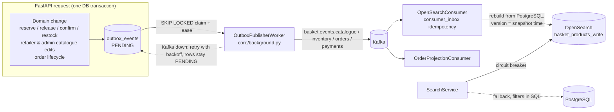
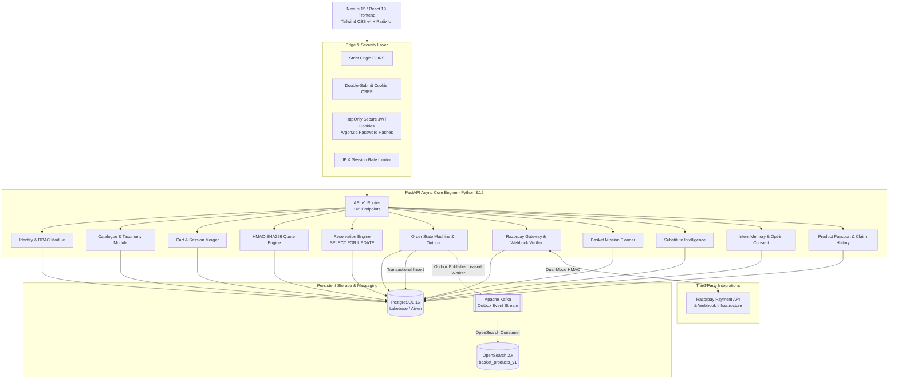
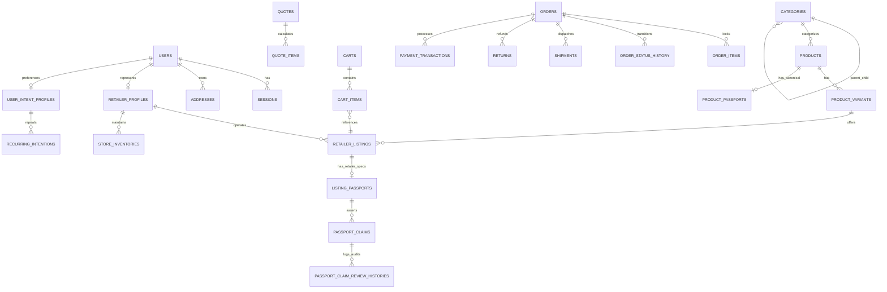

# BASKET — Comprehensive System & Marketplace Architecture

> **Document Version:** 2.0.0  
> **Target Audience:** Engineering Leads, System Architects, Claude Development Team  
> **Repository:** `Rahul2006MILLION/Online_Shopping`  
> **Last Updated:** 2026-11-20  

---

## 0. Runtime Architecture Changes — Stabilisation Audit 2026-11-20

### 0.1 Event flow (as implemented after the audit)



### 0.2 Background worker supervisor (`app/core/background.py`)

Started from the FastAPI lifespan when a database is configured and `BACKGROUND_WORKERS_ENABLED=true`:

* **Outbox publisher:** connects with `AioKafkaEventProducer`; if Kafka is unreachable it retries every 5 s, doubling up to 300 s. Events are never dropped.
* **Reservation expiry** (60 s): releases `ACTIVE` reservations past TTL, one transaction each.
* **Payment reconciliation** (120 s) and **unpaid-order SLA escalation** (300 s).

All jobs are safe across multiple API replicas. For dedicated worker processes, set `BACKGROUND_WORKERS_ENABLED=false` on API pods and run a worker entry point (not yet provided; see technical debt).

### 0.3 Authorisation model for back-office operations

`require_admin_or_internal_service` (identity/dependencies.py) guards fulfilment (shipments), returns lifecycle and refunds: either an admin user (JWT; cookie callers must pass CSRF) or a service presenting `X-Internal-Service-Key`. Customer-facing refunds happen only through order cancellation and the returns workflow.

### 0.4 Search document versioning

Product documents are rebuilt from PostgreSQL on every event, so the external version is the **time the authoritative state was read** (`core/search/versioning.snapshot_version()`, epoch µs). Older snapshots lose (`409` ignored); newer ones always win regardless of which aggregate triggered them.

---


## 1. Executive Summary & Marketplace Topology

**BASKET** is an enterprise-grade, multi-retailer hyper-local e-commerce marketplace platform engineered for the Indian retail ecosystem. It bridges local neighbourhood stores (*kiranas*, specialty merchants, fashion boutiques, electronics distributors) and multi-chain retail outlets with digital consumers across four major verticals:
1. **Groceries & Daily Essentials** (FMCG, fresh produce, staples, dairy)
2. **Fashion & Apparel** (clothing, footwear, accessories, multi-variant sizing/colours)
3. **Consumer Electronics** (smartphones, audio, appliances, warranties)
4. **Beauty & Personal Care** (skincare, cosmetics, wellness)

### 1.1 The Multi-Stakeholder Model

```
+-----------------------------------------------------------------------------------+
|                                  BASKET PLATFORM                                  |
+-------------------------+-------------------------------+-------------------------+
|      ADMIN PORTAL       |        RETAILER PORTAL        |    CUSTOMER STOREFRONT   |
|   (/admin/*)            |     (/retailer/*)             |    (/, /catalogue, etc)  |
+-------------------------+-------------------------------+-------------------------+
| - Global Taxonomy       | - Store Profile & KYC Docs    | - Universal Multi-Store |
| - Retailer Verification | - Inventory & Stock Mgmt      |   Faceted Search        |
| - Platform Deals & Fees | - Listing Claims & Passports  | - Multi-Retailer Cart   |
| - Passport Claims Queue | - Retailer-specific Offers    | - Goal-Based Missions   |
| - Dispute Moderation    | - Order Dispatch & Tracking   | - Substitute Engine     |
| - Platform Analytics    | - Revenue & Settlement Stats  | - Razorpay Multi-Mode   |
+-------------------------+-------------------------------+-------------------------+
```

### 1.2 Core Architectural Principles
- **Separation of Concerns:** Headless backend with asynchronous RESTful APIs consuming typed JSON payloads, serving a decoupled React 19 / Next.js 15 App Router frontend.
- **Fail-Safe Commerce:** Zero phantom inventory sales via strict row-level transactional locking (`SELECT ... FOR UPDATE`), cryptographic HMAC-signed pricing quotes, and an atomic transactional outbox pattern.
- **Resilient Search & Discovery:** OpenSearch primary faceted search with an automated circuit breaker and transparent PostgreSQL Full-Text Search (`tsvector`) fallback.
- **Transparent Provenance:** Customer-facing Product Passports with canonical specifications and an append-only, auditable administrative claim review history.

---

## 2. End-to-End System Topology



---

## 3. Technology Stack & Runtime Dependencies

### 3.1 Backend Application Stack

| Component | Technology | Version | Purpose |
| :--- | :--- | :--- | :--- |
| **Runtime** | Python | `3.12.14` | High-performance asynchronous execution runtime |
| **Web Framework** | FastAPI | `0.115.11` | ASGI web framework with OpenAPI generation |
| **ASGI Server** | Uvicorn / Standard | `0.34.0` | High-throughput asynchronous server |
| **ORM / Data Access** | SQLAlchemy (Async) | `2.0.38` | Type-annotated async ORM with `asyncpg` |
| **Driver** | asyncpg | `0.30.0` | High-performance PostgreSQL async binary driver |
| **Schema Migrations** | Alembic | `1.15.1` | Linear revision tracking (`0001` through `0020`) |
| **Data Validation** | Pydantic v2 | `2.10.6` | Runtime validation and settings serialization |
| **Password Hashing** | passlib[argon2] | `1.7.4` | Memory-hard Argon2id password hashing |
| **Authentication** | python-jose[cryptography] | `3.4.0` | HMAC-SHA256 JWT access and refresh token signing |
| **Event Streaming** | aiokafka | `0.12.0` | Asynchronous Kafka producer and consumer client |
| **Search Engine** | opensearch-py | `2.8.0` | Faceted search indexing and querying |
| **Payments** | razorpay | `1.4.2` | Payment order creation, verification, and refunds |
| **Metrics** | prometheus-client | `0.21.1` | Exposing `/metrics` for Prometheus scraping |
| **Code Quality** | Ruff | `0.9.10` | High-speed linting, formatting, and import sorting |
| **Test Suite** | pytest / pytest-asyncio | `8.3.5` | 448 unit, integration, and security regression tests |

### 3.2 Frontend Application Stack

| Component | Technology | Version | Purpose |
| :--- | :--- | :--- | :--- |
| **Framework** | Next.js (App Router) | `15.5.29` | Server-rendered & client-hydrated React framework |
| **UI Library** | React | `19.0.0` | Declarative user interface components |
| **Styling** | Tailwind CSS v4 | `4.0.0` | Atomic utility styling with modern CSS engine |
| **Component Primitives**| Radix UI / shadcn/ui | Latest | Accessible unstyled primitives (Dialog, Tabs, etc.) |
| **Icons** | Lucide React | `0.475.0` | Lightweight SVG icons |
| **HTTP Client** | Native Fetch Wrapper | Native | Typed API client (`frontend/lib/api.ts`) with credentials |
| **Type Checking** | TypeScript (Strict) | `5.7.3` | Strict compile-time typing |
| **Testing** | Vitest / Testing Library| `3.0.7` | 100 frontend unit and integration tests |

---

## 4. Authentication, Sessions & RBAC Architecture

### 4.1 Security Boundaries & Credentials
- **Password Hashing:** Passwords are never stored in plaintext. They are hashed using **Argon2id** via `passlib.context.CryptContext(schemes=["argon2"])`.
- **JWT Tokens:**
  - **Access Token:** Short-lived (default: 15 minutes), signed with `HS256`, containing `sub` (User UUID), `role` (`CUSTOMER`, `RETAILER`, `ADMIN`), and `jti` (unique token ID).
  - **Refresh Token:** Long-lived (default: 7 days), stored in the `sessions` table.
- **Cookie Security:**
  - `access_token` and `refresh_token` are set as `HttpOnly`, `Secure` (in production), and `SameSite=Lax`.
  - CSRF Token: Handled via double-submit cookie pattern (`X-CSRF-Token` header validated against client-accessible cookie for state-changing operations).

### 4.2 Role-Based Access Control (RBAC) Matrix

| Endpoint Group | `GUEST` (Unauthenticated) | `CUSTOMER` | `RETAILER` | `ADMIN` |
| :--- | :---: | :---: | :---: | :---: |
| **Public Catalogue & Search** | Read-Only | Read-Only | Read-Only | Read-Only |
| **Cart Operations** | Read / Write (Session ID) | Read / Write | Read / Write | Read / Write |
| **Cart Merge (`/cart/merge`)**| Blocked (401) | Allowed | Blocked (403) | Blocked (403) |
| **Checkout & Quotes** | Allowed (Guest Quote) | Full Access | Full Access | Full Access |
| **Orders & Tracking** | Blocked | Own Orders Only | Assigned Orders | Full Access |
| **Returns & Refunds** | Blocked | Initiate Own | Process Store | Full Access |
| **Basket Mission Planner** | Allowed | Full Access | Full Access | Full Access |
| **Intent Memory (`/intent/*`)**| Blocked (401) | Own Profile Only | Blocked (403) | Blocked (403) |
| **Retailer Portal (`/retailer/*`)**| Blocked (401) | Blocked (403) | Verified Store Only | Super-admin Access |
| **Admin Portal (`/admin/*`)** | Blocked (401) | Blocked (403) | Blocked (403) | Full Access |
| **Passport Moderation Queue** | Blocked (401) | Blocked (403) | Blocked (403) | Full Access |

---

## 5. Database Schema & Migration Lineage

The database uses PostgreSQL with 20 sequentially applied, linear Alembic migrations.

```
0001_initial_baseline
  └── 0002_catalogue_schema
        └── 0003_identity_schema
              └── 0004_cart_schema
                    └── 0005_pricing_quotes_schema
                          └── 0006_inventory_reservations_schema
                                └── 0007_orders_outbox_schema
                                      └── 0008_payments_razorpay_schema
                                            └── 0009_outbox_lease
                                                  └── 0010_consumer_inbox
                                                        └── 0011_order_postpurchase
                                                              └── 0012_multi_role_portals_and_retailer_profiles
                                                                    └── 0013_retailer_inventory
                                                                          └── 0014_admin_moderation_deals
                                                                                └── 0015_order_item_fulfillment
                                                                                      └── 0016_basket_mission
                                                                                            └── 0017_basket_intent_memory
                                                                                                  └── 0018_personalization_opt_in
                                                                                                        └── 0019_product_passport
                                                                                                              └── 0020_claim_review_history (HEAD)
```

### 5.1 Relational Schema Topology



---

## 6. Core Commerce Engineering Pillars

### 6.1 Cryptographic Pricing Quotes
To prevent cart price tampering, race conditions on flash discounts, and stale checkout states, checkout never accepts arbitrary prices from the client.
1. The client invokes `/api/v1/checkout/quote`.
2. The pricing engine calculates item subtotal, tier volume discounts, platform discounts, retailer-specific deals, and intra-state (CGST + SGST) vs inter-state (IGST) taxes.
3. An HMAC-SHA256 signature is generated over the immutable fields:
   $$\text{HMAC}(\text{QuoteId} + \text{UserId} + \text{FinalAmount} + \text{ExpiresAt}, \text{SECRET\_KEY})$$
4. Quotes expire strictly after 5 minutes (`expires_at`).
5. When creating an order, the signature and expiration are verified cryptographically. If any listing price, stock, or tax changed, the quote is rejected.

### 6.2 Concurrency-Safe Inventory Reservations
To eliminate overselling and phantom inventory:
1. When checkout proceeds, the reservation engine executes:
   ```sql
   SELECT * FROM retailer_inventory 
   WHERE listing_id = :id 
   FOR UPDATE;
   ```
2. If available quantity $\ge$ requested quantity:
   - `reserved_quantity` is incremented.
   - An expiring `inventory_reservations` record is created with a 10-minute TTL.
3. If payment succeeds, `reserved_quantity` is converted to a permanent deduction of `quantity`.
4. If payment fails or reservation expires, a scheduled background job or cancellation hook automatically releases the hold.

### 6.3 Transactional Outbox Pattern & Event Streaming
To guarantee zero message loss during order creation:
1. Order creation, inventory deduction, and outbox event insertion happen in a **single database transaction**:
   ```sql
   INSERT INTO orders ...;
   INSERT INTO order_items ...;
   INSERT INTO outbox_events (id, aggregate_type, payload, status) VALUES (...);
   COMMIT;
   ```
2. A resilient background worker acquires a durable lease on outbox events:
   ```sql
   UPDATE outbox_events 
   SET lease_holder = :worker_id, leased_until = :now + interval '30s'
   WHERE status = 'PENDING' AND (leased_until IS NULL OR leased_until < :now)
   LIMIT 50;
   ```
3. The worker publishes events (`OrderCreated`, `PaymentCompleted`) to Apache Kafka.
4. Downstream consumers (OpenSearch Search Indexer, Notification Service) record processed message IDs into the `consumer_inbox` table to guarantee idempotent, exactly-once processing.

### 6.4 Search Engine Architecture & Circuit Breaker
1. **Primary Search:** Powered by OpenSearch 2.x on index `basket_products_v1`, supporting fuzzy queries, category faceted counts, brand filters, price range histograms, and multi-field boosting.
2. **Circuit Breaker:** If OpenSearch fails or response latency exceeds 1.5 seconds, the system trips a circuit breaker into `DEGRADED` state.
3. **Transparent Fallback:** Search requests automatically divert to PostgreSQL Full-Text Search using indexed `tsvector` columns on products and categories without dropping customer requests.

### 6.5 Razorpay Payment Gateway Integration
1. **Dual-Mode Operation:**
   - **Sandbox Mode:** Used for automated test pipelines, mock validation, and local staging without requiring live banking credentials.
   - **Production Mode:** Directly interacts with Razorpay Orders API, generating `order_id` and passing it to the checkout frontend.
2. **Cryptographic Webhook Verification:**
   - Webhook events (`order.paid`, `payment.failed`, `refund.processed`) are signed with the Razorpay Webhook Secret.
   - Backend validates `X-Razorpay-Signature` using `hmac.new(webhook_secret, body, hashlib.sha256)`.
   - Prevents replay attacks and fake payment confirmation calls.

---

## 7. Customer Intelligence Engine (Phase 2)

### 7.1 Phase 2A — Basket Mission Planner
Goal-based basket planning solving the 0/1 knapsack optimization problem:
- Users input budget, group size, and category criteria (e.g. "Weekly Family Groceries under ₹2,000").
- The engine groups essential items, optimizes retailer distribution for minimal shipping fees, and allows one-click population into the universal cart.

### 7.2 Phase 2B — Substitute Intelligence
Automated alternative discovery across 5 explainable tiers:
1. `CLOSEST_MATCH`: Same category, identical primary attributes.
2. `BUDGET_FRIENDLY`: Lower price per unit in same category.
3. `BETTER_VALUE`: Larger pack size or lower unit cost.
4. `PREMIUM_UPGRADE`: Higher customer rating, verified organic or premium claims.
5. `AVAILABLE_NOW`: In-stock alternatives from nearby retailers when current listing is out-of-stock.
- Features a side-by-side specification comparison matrix and atomic cart replacement API (`/api/v1/cart/items/{id}/replace`).

### 7.3 Phase 2C — Basket Intent Memory
Customer-controlled preference and recurring shopping intentions:
- Remembers dietary restrictions, brand affinities, preferred package sizes, and delivery schedules.
- **Strict Opt-in Consent:** Personalization is disabled by default (`personalization_enabled = False`). Saved preferences only influence recommendations once the customer explicitly toggles consent. Includes one-click clear memory functionality (`DELETE /api/v1/intent/clear-all`).

### 7.4 Phase 2D — Product Passport & Claim Moderation
Product transparency and verification framework:
- **Canonical Passports:** Global product attributes (ingredients, origin, certifications, dimensions).
- **Listing Passports:** Retailer-specific conditions (batch numbers, expiry dates, storage condition).
- **Claim Moderation:** Retailer assertions (e.g. "100% Organic", "Next-Day Delivery") must be verified by platform admins.
- **Auditable Review Trail:** Powered by `0020_claim_review_history`, preserving an immutable history of every approval, rejection reason, reviewer ID, timestamp, and revision payload.

---

## 8. Development, Testing & Verification Commands

```bash
# 1. Backend Linting & Formatting
cd backend
../backend/.venv/bin/ruff check .
../backend/.venv/bin/ruff format .

# 2. Run Full Backend Test Suite (448 tests)
PYTHONPATH=. pytest -v

# 3. Database Migrations
alembic current
alembic upgrade head

# 4. Frontend Type-Check & Linting
cd ../frontend
npm run type-check
npm run lint

# 5. Frontend Test Suite (100 tests)
npm test

# 6. Production Frontend Build
npm run build
```
