<div align="center">


<h3>A multi-retailer, multi-category marketplace for Indian retail</h3>

<p>
Neighbourhood kirana stores, regional specialists and organised brands — one catalogue, one cart, one secure checkout.
</p>

<p>


</p>

<p>
<a href="https://basket-omega-three.vercel.app"><b>Live demo</b></a> ·
<a href="#-screenshots">Screenshots</a> ·
<a href="#-getting-started">Getting started</a> ·
<a href="#-api-overview">API</a> ·
<a href="#-razorpay-integration">Payments</a> ·
<a href="#-deployment">Deployment</a>
</p>

</div>

---

> [!NOTE]
> Basket runs as a **labelled demonstration environment**. Stores and catalogue data are seeded demo data, and payments use **Razorpay test mode** — no real money moves.

## 📑 Table of contents

1. [Introduction](#-introduction)
2. [The problem](#-the-problem)
3. [The solution](#-the-solution)
4. [Core features](#-core-features)
5. [Technology stack](#-technology-stack)
6. [System architecture](#-system-architecture)
7. [Project structure](#-project-structure)
8. [Getting started](#-getting-started)
9. [Environment variables](#-environment-variables)
10. [API overview](#-api-overview)
11. [Razorpay integration](#-razorpay-integration)
12. [Security](#-security)
13. [Screenshots](#-screenshots)
14. [Testing](#-testing)
15. [Deployment](#-deployment)
16. [Contributing](#-contributing)
17. [License](#-license)
18. [Credits](#-credits)

---

## 🧺 Introduction

**Basket** is a hyper-local, multi-retailer e-commerce marketplace built for how India actually shops. Customers browse one unified catalogue spanning groceries, fashion, electronics, beauty, home and more; every product can be offered by several verified stores, each with its own price, stock and delivery rules. A single cart can hold items from many sellers, and checkout splits fulfilment per store while the customer pays once.

Behind the storefront sit two dedicated workspaces: a **Retailer Centre** where stores manage listings, inventory, offers and a five-stage fulfilment pipeline, and an **Admin console** for marketplace governance, store verification and audit.

## 🧩 The problem

- **Fragmented local retail.** Neighbourhood stores have stock and competitive prices but no shared digital shelf; customers can't compare them in one place.
- **Untrustworthy prices at checkout.** Prices computed in the browser can be tampered with, and GST breakdowns are often opaque.
- **Overselling.** Without stock holds, two customers can pay for the last unit.
- **Payment edge cases.** Lost callbacks, duplicate webhooks and half-finished payments leave orders in limbo.
- **Language barriers.** A large share of shoppers prefer to browse in their own language.

## 💡 The solution

| Challenge | How Basket handles it |
|---|---|
| Fragmented retail | One catalogue with **multi-store listings**, price comparison and a unified multi-seller cart |
| Price tampering | **Server-signed checkout quotes** (HMAC-SHA256); the browser never decides an amount |
| Transparent tax | Statutory **GST at HSN rates**, split into CGST + SGST (intra-state) or IGST (inter-state) |
| Overselling | **Inventory reservations** with a time-limited hold and optimistic locking |
| Reliable payments | **Server-side Razorpay verification**, idempotent attempts, durable webhooks and reconciliation jobs |
| Reliable events | **Transactional outbox** (Kafka or in-process delivery) so state changes and events never diverge |
| Language | **12 Indian languages** for the interface plus translated catalogue content |

## ✨ Core features

### 🛍️ Customer

- Category browsing, search with filters and sorting (PostgreSQL full-text search, optional OpenSearch)
- Product pages with multi-store offers, variants, product passport (origin, ingredients, allergens) and price history
- Persistent cart (guest → account merge), coupon codes, per-seller delivery rules
- Stock hold → address confirmation → **Razorpay checkout** → server-verified confirmation
- Order tracking, cancellations, returns (15-day window) and refunds
- Wishlist, price alerts, recurring "Monthly Essentials" baskets
- Smart shopping: **Missions** (goal-based baskets), substitute suggestions, list-to-basket, deal assistant
- Community: group buying, Request-a-Quote exchange, **Dukaan vs Dukaan** reverse auctions, Sale Stream flash deals
- Interface in 12 languages

### 🏪 Retailer

- Store dashboard with live KPIs (orders to fulfil, revenue, stock on hand, low-stock alerts)
- Listings, variants, images and inventory management
- Five-stage fulfilment: `CONFIRMED → PROCESSING → PACKED → SHIPPED → DELIVERED`
- Offers and discounts, pricing insights versus other stores
- Demand gaps, RFQ bidding, group-buy templates, auctions and negotiation rules
- Onboarding with GSTIN and document verification

### 🛡️ Admin

- Marketplace overview (paid revenue, orders, active customers, stores)
- Store verification and compliance, catalogue moderation, deals and promotions
- Demand intelligence, RFQs, group buying and auction oversight
- Price intelligence, user management, orders, **audit logs** and system health

## 🛠️ Technology stack

| Layer | Technology |
|---|---|
| **Frontend** | Next.js 15 (App Router), React 19, TypeScript 5, Tailwind CSS 3.4, Framer Motion, Lucide icons |
| **Backend** | FastAPI (Python 3.12) modular monolith, Pydantic v2 + pydantic-settings, Uvicorn |
| **Data** | PostgreSQL 16, SQLAlchemy 2 (async, asyncpg), Alembic (40 migrations) |
| **Auth** | Argon2id password hashing, JWT in HTTP-only cookies, double-submit CSRF, role-based access (customer / retailer / admin) |
| **Payments** | Razorpay Orders + Standard Checkout, HMAC-SHA256 signature and webhook verification |
| **Events & search** | Transactional outbox → Kafka (`aiokafka`) or in-process; OpenSearch with PostgreSQL FTS fallback |
| **Realtime** | Server-Sent Events for live order, auction and stock updates |
| **Quality** | pytest + pytest-asyncio, Ruff, Node test runner, ESLint, `tsc --noEmit`, GitHub Actions CI |
| **Hosting** | Vercel (frontend) · Render (API, Docker) · managed PostgreSQL |

## 🏗️ System architecture

The browser only ever talks to the Next.js app. In hosted mode Next.js **proxies `/api/v1` to the FastAPI backend on the same origin**, so auth and CSRF cookies stay first-party and no backend URL is exposed to the client.

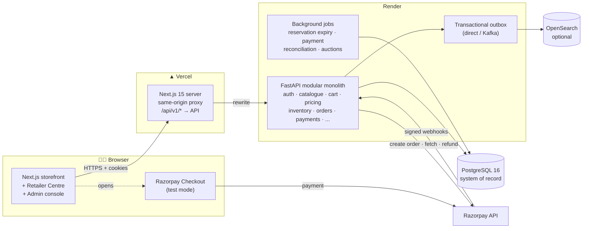

### Checkout and payment flow

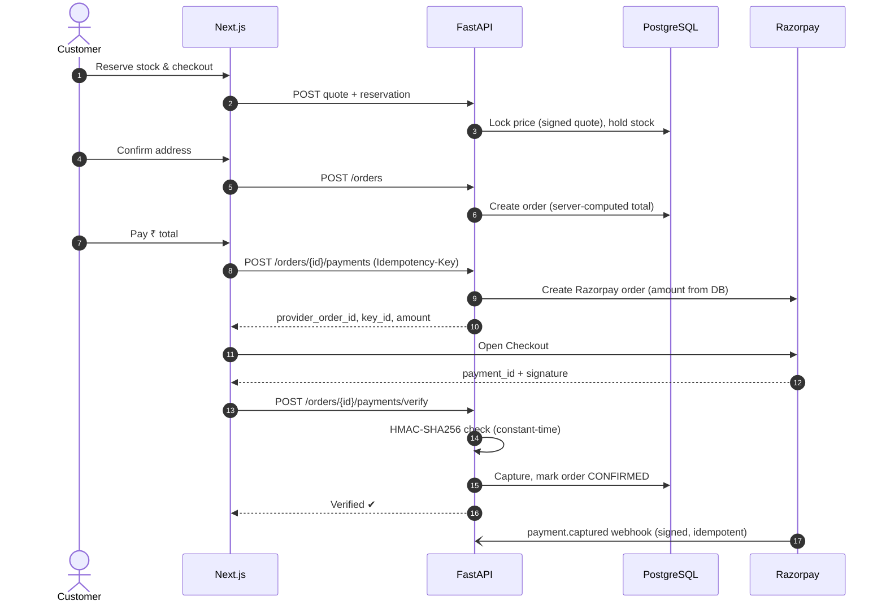

## 📁 Project structure

```text
Online_Shopping/
├── frontend/                  # Next.js 15 app (deployed to Vercel)
│   ├── app/                   # App Router routes
│   │   ├── page.tsx, products/, categories/, cart/, checkout/, orders/, account/, ...
│   │   ├── retailer/          # Retailer Centre: listings, inventory, orders, analytics, ...
│   │   └── admin/             # Admin console: retailers, catalogue, deals, audit logs, ...
│   ├── components/            # UI, catalogue, checkout (Razorpay), home, layout
│   ├── lib/                   # Typed API client, auth, i18n, pricing, realtime (SSE)
│   ├── locales/               # 12 language dictionaries
│   └── public/brand/          # Logo and brand artwork
├── backend/                   # FastAPI service (deployed to Render via Docker)
│   ├── app/
│   │   ├── api/v1/            # Router composition (/api/v1)
│   │   ├── core/              # Settings, database, logging, background jobs
│   │   ├── modules/           # Domain modules: identity, catalogue, cart, pricing, inventory,
│   │   │                      #   orders, payments, retailer, admin, search, missions, auctions, ...
│   │   └── seeds/             # Idempotent, clearly-labelled demo data
│   ├── alembic/               # 40 database migrations
│   ├── tests/                 # pytest suite
│   ├── Dockerfile
│   └── docker-entrypoint.sh   # migrate → (optional) seed → serve on $PORT
├── deploy/                    # Docker Compose stacks (sandbox, shared demo)
├── scripts/                   # Setup, audits, migration checks, DB backup/restore
├── docs/                      # Guides and README images
├── render.yaml                # Render Blueprint for the API
└── .github/workflows/ci.yml   # Backend + frontend CI
```

## 🚀 Getting started

### Prerequisites

- **Node.js 22+** and npm
- **Python 3.12+** (with `uv` or `pip`)
- **PostgreSQL 16**
- A **Razorpay test-mode** account for checkout (optional for browsing)

### 1. Clone

```bash
git clone https://github.com/Dhruv-vm/Online_Shopping.git
cd Online_Shopping
```

### 2. Database

```bash
createdb basket_db
```

### 3. Backend

```bash
cd backend
cp .env.example .env            # then edit DATABASE_URL and the Razorpay test keys
uv venv && source .venv/bin/activate
uv pip install -e ".[dev]"

alembic upgrade head            # apply all migrations
python -m app.seeds.seed_demo_marketplace   # optional: labelled demo stores, products and accounts

uvicorn app.main:create_app --factory --reload --port 8000
```

- API: <http://localhost:8000> · Interactive docs: <http://localhost:8000/docs> · Health: <http://localhost:8000/health>

### 4. Frontend

```bash
cd frontend
cp .env.example .env.local      # NEXT_PUBLIC_API_URL=http://localhost:8000
npm install
npm run dev
```

- Storefront: <http://localhost:3000> · Retailer Centre: `/retailer` · Admin console: `/admin`

### Demo accounts

After seeding, these accounts are available (password documented in [`BASKET_V2_DEMO_GUIDE.md`](BASKET_V2_DEMO_GUIDE.md)):

| Role | Email |
|---|---|
| Customer | `customer@basket.demo` |
| Retailer | `retailer1@basket.demo` … `retailer4@basket.demo` |
| Admin | `admin@basket.demo` |

### Docker (optional)

```bash
docker compose -f deploy/docker-compose.sandbox.yml up --build -d
```

## 🔐 Environment variables

Templates live in [`backend/.env.example`](backend/.env.example) and [`frontend/.env.example`](frontend/.env.example). Never commit real values.

### Backend

| Variable | Required | Description |
|---|:-:|---|
| `ENVIRONMENT` | ✔ | `development`, `staging` or `production`. Production requires live Razorpay keys and strong secrets |
| `DATABASE_URL` | ✔ | PostgreSQL URL. `postgres://` / `postgresql://` are converted to the asyncpg driver automatically |
| `DATABASE_SSL_MODE` | | `require` (default), `verify-full`, or `disable` for private networks |
| `SECRET_KEY` | ✔ | Application secret |
| `JWT_SECRET_KEY` | ✔ | Signs access/refresh tokens — always set a long random value outside local dev |
| `CSRF_SECRET_KEY` | ✔ | CSRF token secret |
| `INTERNAL_SERVICE_KEY` | ✔ | Protects internal reconciliation endpoints (≥ 32 chars in production) |
| `CORS_ORIGINS` | ✔ | JSON list of allowed frontend origins |
| `COOKIE_SECURE` | | `true` when served over HTTPS |
| `TRUSTED_PROXY_COUNT` | | Number of reverse proxies in front of the API (Vercel + Render = 2) |
| `RAZORPAY_KEY_ID` | ✔ | Razorpay key id (`rzp_test_…` outside production) |
| `RAZORPAY_KEY_SECRET` | ✔ | Razorpay key secret — **server only** |
| `RAZORPAY_WEBHOOK_SECRET` | ✔ | Webhook signing secret — **server only** |
| `OUTBOX_DISPATCH` | | `kafka` or `direct` (single instance, no broker) |
| `KAFKA_*`, `OPENSEARCH_*` | | Optional event streaming and search infrastructure |
| `SEED_DEMO_DATA` | | Container entrypoint: load labelled demo data on start (`false` by default) |

### Frontend

| Variable | Description |
|---|---|
| `NEXT_PUBLIC_API_URL` | Backend URL (e.g. `http://localhost:8000`) **or** `same-origin` to proxy through Next.js |
| `BASKET_API_PROXY_TARGET` | Server-side only: backend origin used when `NEXT_PUBLIC_API_URL=same-origin` |
| `NEXT_PUBLIC_ENVIRONMENT` | Display label: `development`, `staging`, `production` |

> The Razorpay **key id** reaches the browser from the backend for each payment; no Razorpay secret is ever bundled into the frontend.

## 📡 API overview

All endpoints are served under **`/api/v1`** with a consistent error envelope (`{ "error": { "code", "message", "request_id", "details" } }`). Full interactive documentation is available at `/docs` in non-production environments; see also [`API_INVENTORY.md`](API_INVENTORY.md).

| Area | Examples |
|---|---|
| Identity | `POST /auth/register`, `POST /auth/login`, `POST /auth/refresh`, `GET /users/me`, addresses |
| Catalogue & search | `GET /categories`, `GET /products`, `GET /products/{slug}`, `GET /retailers`, search |
| Cart & pricing | `GET /cart`, cart lines, signed quotes, discount codes |
| Inventory | stock reservations (hold / release) |
| Orders | create, list, track, cancel, return |
| Payments | `POST /orders/{id}/payments`, `POST /orders/{id}/payments/verify`, `POST /payments/webhook`, admin refunds |
| Retailer | listings, inventory, offers, fulfilment, analytics, demand, RFQ bids, auctions |
| Admin | retailers & verification, catalogue, deals, users, orders, audit logs, system health |
| Marketplace | missions, substitutes, passport, price intelligence, sale stream, community buying, exchange, negotiation, auctions, recurring baskets |
| Realtime | Server-Sent Events streams for live updates |
| Health | `GET /health` (liveness) |

## 💳 Razorpay integration

Basket uses **Razorpay Orders + Standard Checkout** with every money-related decision made on the server.

1. **Server-side amount.** The order total is computed and stored by the backend from a signed quote. The payment endpoint reads the amount from the database — never from the request.
2. **Order creation.** `POST /orders/{id}/payments` creates a Razorpay order (amount in paise, INR) and returns only the public key id, provider order id and amount.
3. **Idempotency.** Each attempt carries an `Idempotency-Key`; retries replay the same Razorpay order instead of creating duplicates, and an already-paid order cannot be paid again.
4. **Signature verification.** After checkout, `POST /orders/{id}/payments/verify` recomputes `HMAC_SHA256(order_id|payment_id, key_secret)` with a constant-time comparison. Only a valid signature captures the payment and confirms the order.
5. **Webhooks.** `POST /payments/webhook` verifies `X-Razorpay-Signature` against the **raw request body** and the webhook secret, stores each event durably, and processes it under a lease, so duplicate or out-of-order deliveries are safe.
6. **Failures and recovery.** Failed and cancelled payments surface a clear message and leave the order unpaid; background reconciliation resolves pending or ambiguous attempts, and an SLA job cancels orders that never complete.

**Webhook URL:** `https://<api-host>/api/v1/payments/webhook` — subscribe to `payment.captured`, `payment.failed`, `refund.processed` and `refund.failed`.

**Test payments:** use Razorpay test mode (`rzp_test_…`) and the test cards / netbanking flows from the [Razorpay docs](https://razorpay.com/docs/payments/payments/test-card-details/). Live mode requires `ENVIRONMENT=production` with `rzp_live_` keys, and is intentionally not enabled in the demo deployment.

## 🛡️ Security

- **Secrets stay server-side.** Razorpay secrets, JWT/CSRF secrets and database credentials exist only in backend environment variables; `.env` files are git-ignored and excluded from Docker images.
- **Authentication.** Argon2id hashing, short-lived JWT access tokens, refresh-token rotation with reuse detection, HTTP-only `Secure` cookies over HTTPS.
- **CSRF.** Double-submit tokens plus Origin validation on every cookie-authenticated state change.
- **Authorization.** Role-based guards for customer, retailer and admin APIs; retailers only see their own store's data.
- **Integrity.** Signed price quotes, server-computed totals, constant-time HMAC checks, idempotent payment attempts and webhooks.
- **Abuse protection.** Login rate limiting keyed on trusted-proxy-aware client IPs.
- **Auditability.** Admin actions are recorded in an audit log.
- **Production guards.** Startup refuses insecure defaults, test Razorpay keys or placeholder secrets when `ENVIRONMENT=production`.

Found a vulnerability? Please report it privately to the maintainers rather than opening a public issue.

## 📸 Screenshots

All screenshots are taken from the running application with seeded demo data.

### Storefront

<table>
  <tr>
    <td width="50%">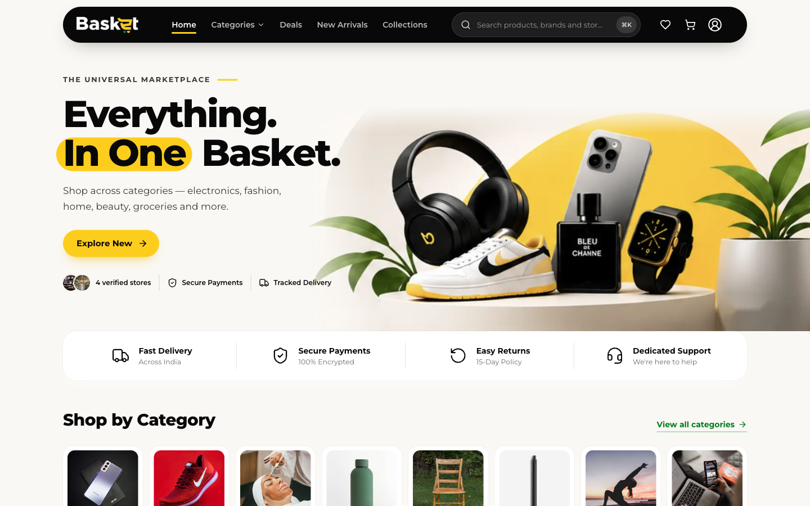<p align="center"><b>Homepage</b></p></td>
    <td width="50%">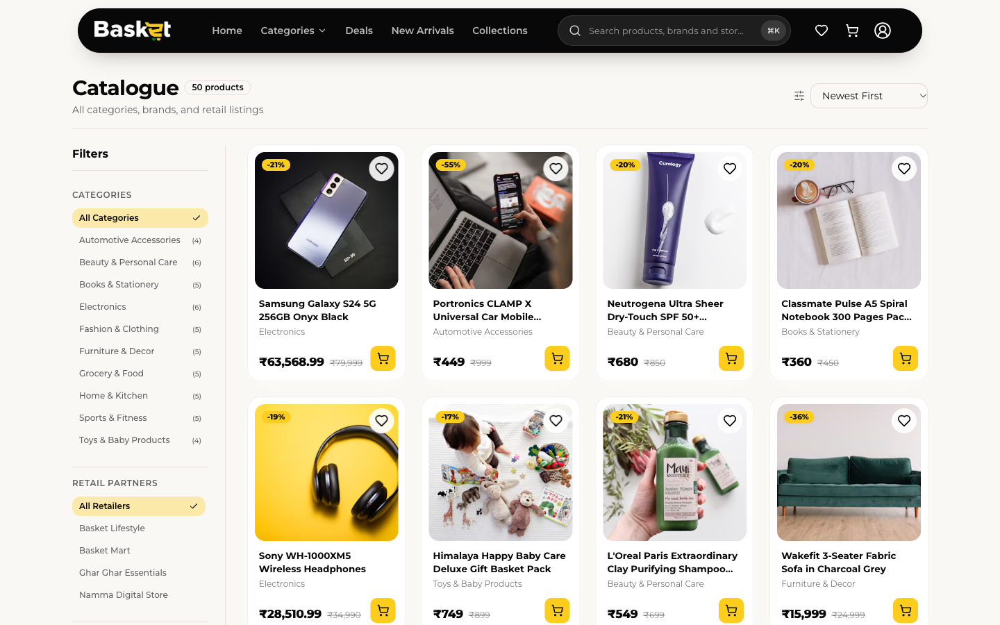<p align="center"><b>Catalogue & filters</b></p></td>
  </tr>
  <tr>
    <td width="50%">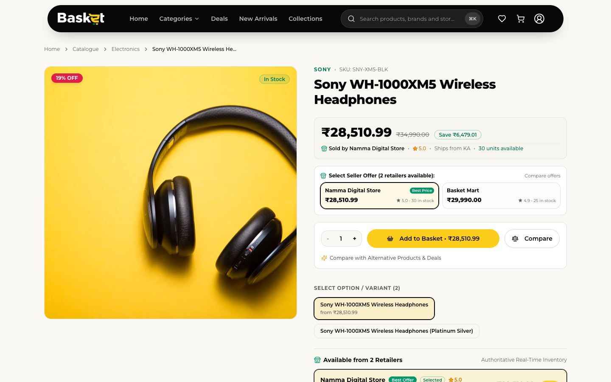<p align="center"><b>Product page · multi-store offers</b></p></td>
    <td width="50%">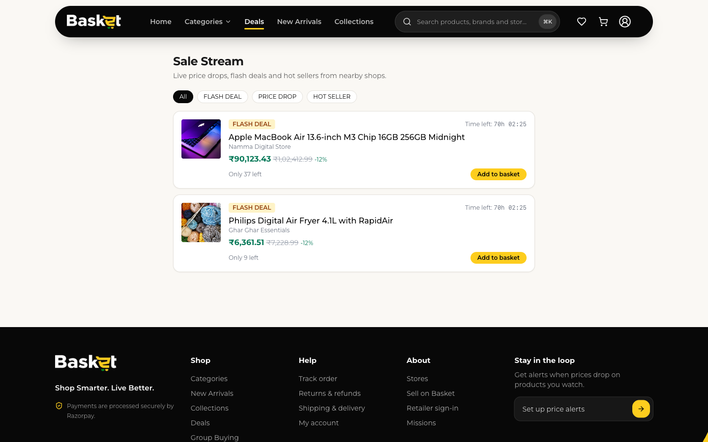<p align="center"><b>Sale Stream deals</b></p></td>
  </tr>
</table>

### Customer journey

<table>
  <tr>
    <td width="50%">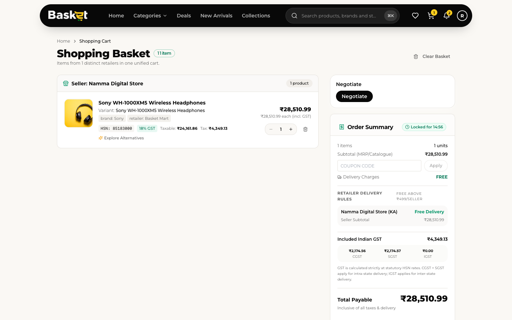<p align="center"><b>Basket · GST breakdown & stock hold</b></p></td>
    <td width="50%">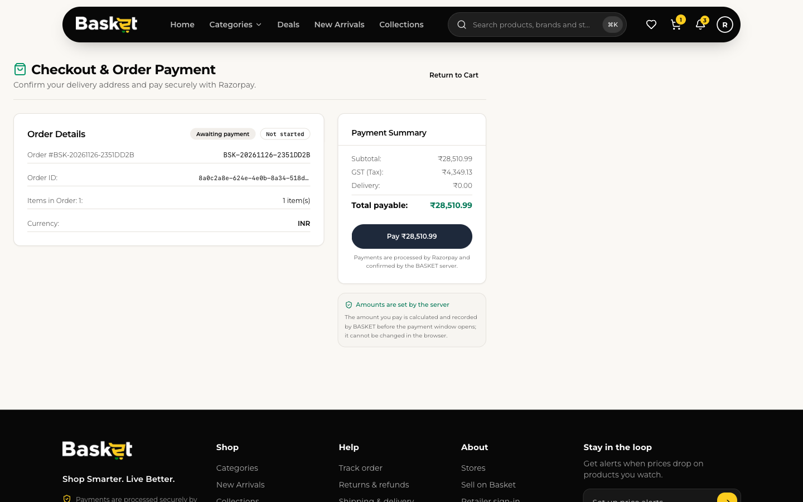<p align="center"><b>Checkout · server-set amount</b></p></td>
  </tr>
  <tr>
    <td colspan="2">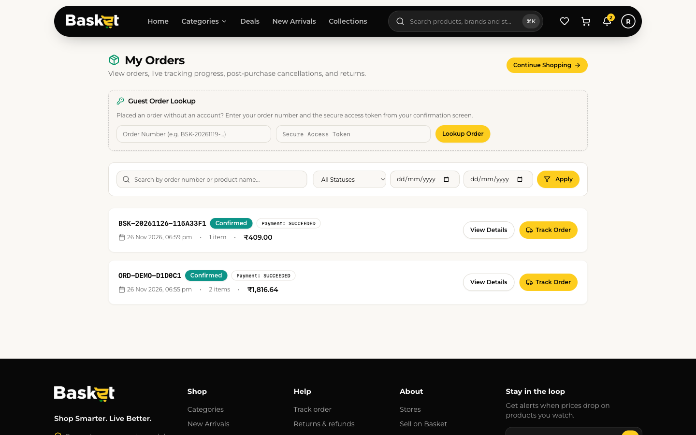<p align="center"><b>My Orders · tracking and payment status</b></p></td>
  </tr>
</table>

### Retailer Centre

<table>
  <tr>
    <td width="50%">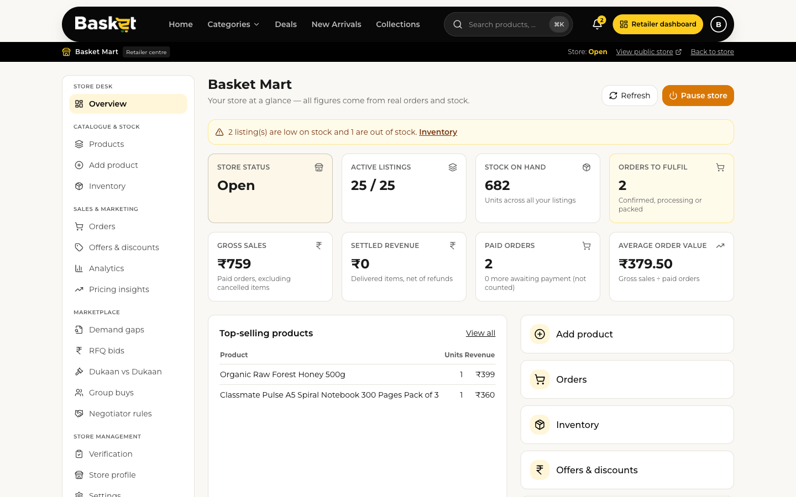<p align="center"><b>Store dashboard</b></p></td>
    <td width="50%">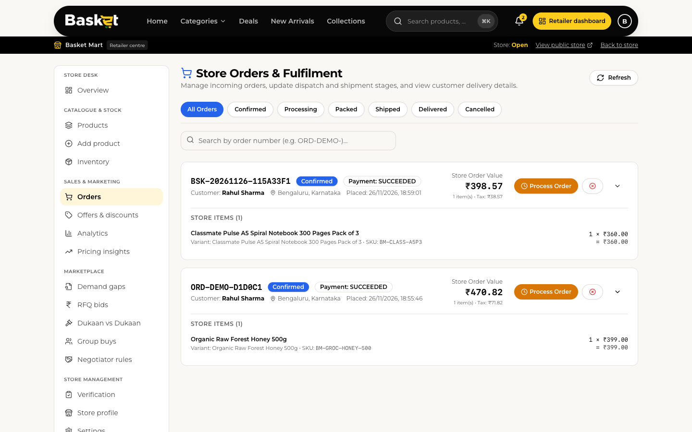<p align="center"><b>Orders & fulfilment</b></p></td>
  </tr>
</table>

### Admin console

<p align="center">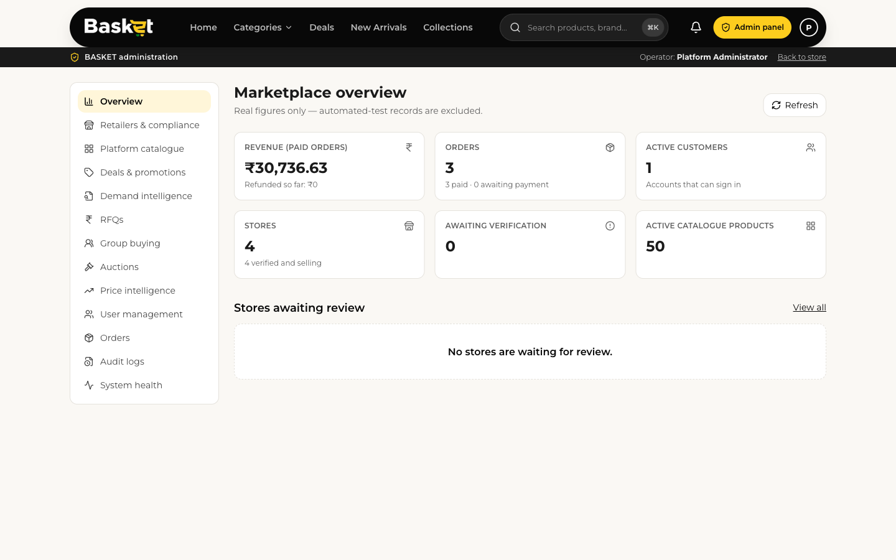</p>

## 🧪 Testing

```bash
# Backend — runs against an isolated <db>_test database
cd backend && pytest -q

# Backend lint & format
ruff check . && ruff format --check .

# Frontend
cd frontend
npm test            # unit + API-contract tests (Node test runner)
npm run type-check  # tsc --noEmit
npm run lint
npm run build
```

| Suite | Result (latest local run) |
|---|---|
| Backend (pytest) | 621 passed, 3 skipped |
| Frontend (node:test) | 129 passed |
| TypeScript | 0 errors |
| Production build | ✔ |

Continuous integration runs the backend and frontend checks on every push and pull request to `main` ([`ci.yml`](.github/workflows/ci.yml)).

## ☁️ Deployment

| Component | Platform | URL |
|---|---|---|
| Frontend | Vercel (project `basket`, root `frontend/`) | <https://basket-omega-three.vercel.app> |
| API | Render web service `basket-api` (Docker, Singapore) | <https://basket-api-yugw.onrender.com> |
| Database | Managed PostgreSQL 16 | private |

**Frontend (Vercel)** — set `NEXT_PUBLIC_API_URL=same-origin`, `BASKET_API_PROXY_TARGET=<API URL>` and `NEXT_PUBLIC_ENVIRONMENT` for both Production and Preview, then deploy from the repository root (the project's root directory is `frontend/`).

**API (Render)** — the [`render.yaml`](render.yaml) Blueprint builds `backend/Dockerfile`. On start, [`docker-entrypoint.sh`](backend/docker-entrypoint.sh) applies migrations, optionally seeds demo data and serves on `$PORT`. Secrets (`RAZORPAY_*`, `DATABASE_URL`, `CORS_ORIGINS`) are entered in the Render dashboard; JWT, CSRF and internal keys are generated by Render.

> [!IMPORTANT]
> The demo API runs on Render's free tier, which sleeps after ~15 minutes without traffic. The first request after that can take up to a minute while it wakes up.

## 🤝 Contributing

1. Fork the repository and create a branch: `git checkout -b feature/short-description`
2. Keep changes focused; follow the existing module boundaries (`backend/app/modules/<domain>`) and UI conventions.
3. Add or update tests, then run the full check list in [Testing](#-testing).
4. Use [Conventional Commits](https://www.conventionalcommits.org/) (`feat:`, `fix:`, `docs:` …).
5. Open a pull request against `main` describing the change, how it was tested and any screenshots for UI work.

Please never commit `.env` files, keys or customer data.

## 📄 License

No open-source license has been chosen for this project yet, so all rights are reserved by the authors. Please contact the maintainers before reusing the code.

## 🙏 Credits

- **Dhruv V M** ([@Dhruv-vm](https://github.com/Dhruv-vm)) — project lead and primary developer
- **Rahul Jain** ([@Rahul2006MILLION](https://github.com/Rahul2006MILLION)) — contributor, upstream repository
- Product photography in the demo catalogue via [Unsplash](https://unsplash.com); payments by [Razorpay](https://razorpay.com); hosting by [Vercel](https://vercel.com) and [Render](https://render.com).

<div align="center">
<sub>Built in India · <b>Basket</b> — Everything. In One Basket.</sub>
</div>
