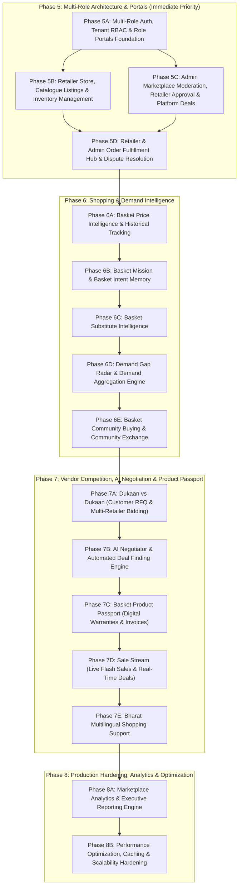

# BASKET — Comprehensive Implementation Roadmap & Master Execution Plan

> **Authoritative Baseline:** [`docs/product/ONLINE_SHOPPING_FEATURES.md`](product/ONLINE_SHOPPING_FEATURES.md)  
> **Architecture Governance:** [`PROJECT_MASTER.md`](../PROJECT_MASTER.md) & [`ARCHITECTURE.md`](../ARCHITECTURE.md)  
> **Current Verified Baseline:** Version `0.5.0` (Phases 0–4 Merged on `integration`)  
> **Status:** Active Master Engineering Roadmap  
> **Last Updated:** 2026-11-19  

---

## 1. Executive Summary & Product Vision

BASKET is an enterprise-grade, multi-category, multi-retailer online shopping platform engineered for modern Indian commerce. It is fundamentally distinct from single-vendor stores, food-only apps, or basic ecommerce clones.

The finalized product architecture orchestrates three autonomous roles:
1. **Admin:** Controls the marketplace, global catalogue, retailer lifecycle, platform discounts, platform tax policies, demand intelligence, dispute resolution, and aggregate analytics.
2. **Retailer:** Operates a dedicated store within the marketplace, controls store profiles, listing pricing, stock levels, promotions, order fulfillment, return approvals, and participates in demand-driven group purchasing and vendor competition (*Dukaan vs Dukaan*).
3. **Customer / Purchaser:** Enjoys smart multi-category shopping, sets shopping objectives via *Basket Mission*, tracks unfulfilled shopping missions with *Basket Intent Memory*, finds value with *Substitute Intelligence*, aggregates demand via *Demand Gap* and *Community Buying*, negotiates competitive deals through *AI Negotiator* and *Dukaan vs Dukaan*, tracks historical prices via *Price Intelligence*, and retains digital warranties and service records through the *Basket Product Passport*.

This roadmap provides a complete, dependency-aware execution plan that translates every feature from the finalized specification into verifiable, modular engineering deliverables.

---

## 2. Complete Feature Audit & Current Status Matrix

Every feature from `ONLINE_SHOPPING_FEATURES.md` is cataloged and classified under one of four statuses:
- **Implemented & Verified:** Fully built, tested end-to-end, backed by database models, and verified by passing automated tests.
- **Partially Implemented:** Fundamental backend primitives or UI components exist, but role-based management, workflow completeness, or UI integration is incomplete.
- **Implemented but Not Sufficiently Verified:** Code exists in some form, but lacks automated tests or rigorous verification.
- **Not Implemented:** No dedicated models, APIs, or role-scoped workflows exist yet.

### 2.1 Role 1: Admin Panel (10 Subsystems)

| Subsystem | Requirement Breakdown | Current Status | Implemented Primitives | Missing Components |
|---|---|:---:|---|---|
| **1.1 Product Management** | Add/edit/deactivate canonical products, categories, subcategories, attributes, images, brands, variants. | **Partially Implemented** | Database models for `Product`, `Category`, `ProductVariant`, `ProductImage` exist; public browsing endpoints exist. | No Admin CRUD APIs (`POST/PUT/DELETE /api/v1/admin/products`), category taxonomy editor, image manager, or `/admin/catalogue` UI. |
| **1.2 Platform Deals & Promotions** | Platform-wide discounts, flash sales, coupon codes, festival sales, eligibility rules, promotional banners. | **Partially Implemented** | `Discount` model, coupon code validation, and calculation engine exist in `pricing` module. | No Admin promotion creation APIs, flash sale schedulers, banner manager, or `/admin/promotions` UI. |
| **1.3 Retailer Management** | Onboarding approvals, document verification, suspension/activation, performance monitoring, dispute management. | **Partially Implemented (Phase 5A)** | `Retailer` tenant columns, verification status (`PENDING`, `VERIFIED`, `SUSPENDED`), Admin list & verify APIs. | Document upload storage UI, automated dispute mediation. |
| **1.4 Customer Management** | Customer account oversight, account restrictions, activity monitoring, support cases, complaint resolution. | **Not Implemented** | `User` model exists with customer registration and auth. | No Admin customer listing, account restriction toggles, complaint management, or `/admin/customers` UI. |
| **1.5 Demand Intelligence Management** | Aggregated product demand, Demand Gap review, unmet demand thresholds, group-buy oversight, demand broadcast to retailers. | **Not Implemented** | None. | No demand aggregation models, threshold triggers, retailer broadcast workers, or `/admin/demand` UI. |
| **1.6 Dukaan vs Dukaan Management** | Retailer competition workflows, RFQ process oversight, bidding rules, vendor response review, dispute resolution. | **Not Implemented** | None. | No RFQ models, auction/bidding logic, bid validation, or `/admin/dukaan-vs-dukaan` UI. |
| **1.7 Tax & Pricing Configuration** | Platform tax rules, statutory GST settings, commissions, service fees, shipping-fee rules, pricing compliance. | **Partially Implemented** | Statutory GST computation (`pricing_service.py`), HSN code validation, intra/inter-state IGST/CGST/SGST logic. | Dynamic platform commissions, service fee models, shipping fee rules engine, or `/admin/pricing-tax` UI. |
| **1.8 Order & Transaction Management** | Marketplace-wide order visibility, transaction monitoring, platform cancellations, manual refunds, dispute oversight. | **Partially Implemented** | Order state machine, payment capture, automated customer cancellation & return workflows (Phase 4). | No cross-retailer Admin order oversight API, manual refund override, dispute resolution, or `/admin/orders` UI. |
| **1.9 Analytics & Reports** | Total sales, revenue, retailer counts, customer counts, product/category performance, conversion metrics, growth reports. | **Not Implemented** | Raw data in PostgreSQL tables (`orders`, `order_items`, `users`, `retailers`). | No aggregation queries, reporting endpoints, time-series metrics, or `/admin/analytics` UI. |
| **1.10 Platform Configuration** | Homepage content management, featured products, banner carousel, announcements, system policies, permissions. | **Not Implemented** | Static homepage layout in `frontend/app/page.tsx`. | Dynamic CMS models for banners, announcements, homepage product curated slots, or `/admin/settings` UI. |

---

### 2.2 Role 2: Retailer Panel (11 Subsystems)

| Subsystem | Requirement Breakdown | Current Status | Implemented Primitives | Missing Components |
|---|---|:---:|---|---|
| **2.1 Store Management** | Store profile, logo, description, images, business address, contact info, business hours, store policies, Open/Closed status. | **Implemented & Verified (Phase 5A)** | `Retailer.user_id` FK to `users.id`, business address, phone, email, JSONB hours/policies, `is_open` toggle, profile API & UI. | Logo upload CDN integration (storing URL directly for now). |
| **2.2 Product Listings** | Add products from platform catalogue, create store listings, upload images, set descriptions, SKU, availability, listing status. | **Partially Implemented** | `ProductListing` model, relations to variants and inventory; public catalogue display. | No Retailer-scoped CRUD APIs (`POST/PUT /api/v1/retailer/listings`), SKU manager, status toggles, or `/retailer/listings` UI. |
| **2.3 Product Pricing** | Set selling price, MRP, discounted price, variant prices, bulk pricing, quantity discounts, minimum order quantity (MOQ). | **Partially Implemented** | `selling_price_paise` and `original_price_paise` on `ProductListing`. | Bulk tiered pricing models, MOQ fields, price update endpoints, or `/retailer/pricing` UI. |
| **2.4 Retailer Offers & Discounts** | Store-wide sales, product/category discounts, coupon codes, bundle offers, offer duration limits, schedule upcoming deals. | **Partially Implemented** | `Discount` model with `listing_id` foreign key. | Retailer-scoped discount creation APIs, bundle discounts, store-wide discount scoping, or `/retailer/offers` UI. |
| **2.5 Tax & Billing** | Applicable tax rates, GST details, tax-inclusive pricing, business tax info, automated invoice generation, tax breakdowns. | **Partially Implemented** | GST line-item tax calculation in quotes and order items. | Retailer GSTIN storage, invoice PDF generation, tax reporting exports, or `/retailer/tax-billing` UI. |
| **2.6 Inventory Management** | Real-time stock updates, available stock views, low-stock alerts, out-of-stock tracking, bulk stock updates, inventory history. | **Partially Implemented** | `StoreInventory` model, atomic reservation decrement/release. | Retailer inventory adjustment API, low-stock threshold triggers, notification dispatch, or `/retailer/inventory` UI. |
| **2.7 Order Management** | Incoming orders feed, accept/reject orders, process fulfillment, update shipment tracking (carrier, tracking number, URL), returns handling. | **Partially Implemented** | Full 7-stage order state machine, shipment entity, tracking number/carrier columns in `orders`. | Retailer-scoped order list API (`GET /api/v1/retailer/orders`), order accept/reject actions, shipment creation UI (`/retailer/orders`). |
| **2.8 Dukaan vs Dukaan — Retailer Participation** | Receive customer RFQs, submit competitive quotations/bids, offer bulk pricing, respond to group-buy requests, availability confirmation. | **Not Implemented** | None. | Retailer quote submission API, bidding dashboard, RFQ notification listener, or `/retailer/dukaan-vs-dukaan` UI. |
| **2.9 Demand Marketplace** | View aggregated customer demand, discover unmet product demand, respond with offers, participate in community purchasing. | **Not Implemented** | None. | Retailer demand feed API, offer response submission, or `/retailer/demand-marketplace` UI. |
| **2.10 Retailer Analytics** | Store revenue, order volume, product conversion, inventory velocity, customer ratings, best/worst selling items, profit reports. | **Not Implemented** | None. | Analytics aggregation queries, revenue charts, inventory turnover reports, or `/retailer/analytics` UI. |
| **2.11 Retailer Profile & Verification** | Business registration, GSTIN, bank details, document upload, verification status tracking (`PENDING`, `VERIFIED`, `SUSPENDED`). | **Not Implemented** | None. | `RetailerVerification` models, document storage integration, onboarding workflow, or `/retailer/profile` UI. |

---

### 2.3 Role 3: Customer / Purchaser Panel (15 Subsystems)

| Subsystem | Requirement Breakdown | Current Status | Implemented Primitives | Missing Components |
|---|---|:---:|---|---|
| **3.1 Smart Shopping** | Search products, category browsing, multi-facet filtering, product comparison, personalized recommendations. | **Implemented & Verified** | Full OpenSearch universal search, Postgres fallback, category tree, faceted filters, product details page. | Product side-by-side comparison modal, algorithmic recommendation engine. |
| **3.2 Basket Mission** | Define shopping mission with budget & purpose, generate complete optimized basket, budget constraints, add/replace items. | **Not Implemented** | Persistent universal cart exists. | Mission intent models, budget optimization engine, multi-item basket generator, or `/mission` UI. |
| **3.3 Basket Intent Memory** | Remember incomplete missions, track spent vs remaining budget, track remaining requirements, resume sessions across devices. | **Not Implemented** | None. | Mission state persistence, budget ledger, session resumption engine, or intent memory drawer UI. |
| **3.4 Basket Substitute Intelligence** | Find alternatives, compare specs, price, quality, compatibility, recommend cheaper/better-value alternatives with explanations. | **Not Implemented** | Catalogue taxonomy & variants exist. | Cross-product similarity scoring, substitute matching algorithm, comparison matrix, or substitute popover UI. |
| **3.5 Demand Gap Results** | Detect unmet search requirements, view similar customer demands, join demand pool, create demand request, get notified. | **Not Implemented** | Zero-result search query capture exists. | Demand pool entities, pool joining endpoints, notification triggers, or `/demand-gap` UI. |
| **3.6 Basket Community Buying** | Group purchases, invite friends/community, track progress toward quantity thresholds, unlock bulk discount tiers. | **Not Implemented** | None. | Group buy group entities, invite tokens, tiered threshold unlock logic, or `/community-buying` UI. |
| **3.7 Basket Community Exchange** | Request unavailable products, aggregate demand, send to retailers, receive & compare retailer bids, purchase on fulfillment. | **Not Implemented** | None. | Request exchange models, retailer broadcast worker, offer aggregator, or `/exchange` UI. |
| **3.8 AI Negotiator** | Set target price/budget, AI compares retailers, analyzes discount opportunities, negotiates available deals, recommends best option. | **Not Implemented** | None. | Negotiation policy rules, retailer discount ceiling matching, recommendation agent, or negotiator widget UI. |
| **3.9 Dukaan vs Dukaan** | Submit requirements, receive multi-retailer offers, compare price, delivery, warranty, ratings, discounts, select best bid. | **Not Implemented** | Multi-retailer listing comparison on product page exists. | Customer RFQ broadcast, quotation receipt inbox, bid comparison matrix, or `/dukaan-vs-dukaan` UI. |
| **3.10 Basket Price Intelligence** | Historical price charts, lowest/highest recorded prices, price drop indicators, current price vs historical average. | **Not Implemented** | Current listing prices recorded in PostgreSQL. | `listing_price_history` tracking table, price history API, chart visualization on product page. |
| **3.11 Basket Product Passport** | Digital ownership history, store invoices, warranty tracking, expiry alerts, service center info, service request workflows. | **Not Implemented** | Immutable purchased item snapshots and order timestamps in PostgreSQL. | `ProductPassport` entity, warranty tracking dates, invoice download generator, service request workflow, or `/account/passport` UI. |
| **3.12 Sale Stream** | Live deal discovery feed, flash sales, trending items, price drop feed, retailer promotions (*Rewind is removed*). | **Partially Implemented** | Category listing and discount displays on storefront. | Live stream event feed, countdown timers for flash sales, trending rank algorithm, or `/sale-stream` UI. |
| **3.13 Bharat Multilingual** | Multilingual shopping, search in regional Indian languages, translate product info and offers (Hindi, Tamil, Telugu, etc.). | **Not Implemented** | UTF-8 support across PostgreSQL and OpenSearch. | Multilingual locale dictionary, i18n routing, translated catalogue projections, or language switcher component. |
| **3.14 Handwritten List (Optional)** | Upload handwritten grocery list, OCR extraction, product name & quantity matching, generate shopping basket. | **Not Implemented (Optional)** | None. | OCR worker, image upload staging, fuzzy catalogue matching pipeline, list review UI. |
| **3.15 Customer Account & Shopping** | Profiles, addresses, cart, checkout, orders, order tracking, cancellations, returns, in-app notifications. | **Implemented & Verified** | Auth, sessions, CSRF, address management, persistent cart, quotes, inventory lock, Razorpay payments, 7-stage order tracking, notifications. | Wishlist management, customer product ratings & review submission. |

---

## 3. Dependency-Aware Phased Execution Plan

The remaining engineering work is structured into four sequential phases, partitioned into independently deployable vertical slices:

---

## 4. Phase-by-Phase Engineering Specifications

### Phase 5: Multi-Role Architecture & Portals (Foundation)

#### Objective
Establish strict role-based access control (RBAC), multi-role authentication, retailer tenancy boundaries, and role-specific portal user interfaces across **Admin**, **Retailer**, and **Customer**.

#### Vertical Slice 5A: Multi-Role Auth, Tenant RBAC & Role Portals Foundation (COMPLETED & VERIFIED)
- **Status:** **Implemented & Verified** (Branch `feature/phase5-multi-role-rbac-foundation`, Migration `0012_multi_role_portals`)
- **Features Covered:** 1.3, 1.10 (Admin Foundation), 2.1, 2.11 (Retailer Foundation), 4.0, 6.0 (RBAC Core).
- **Database Schema Changes:**
  - Alembic migration `0012_multi_role_portals_and_retailer_profiles`:
    - Alter `retailers` table: add `user_id` (UUID, Foreign Key to `users.id`, nullable for legacy seed data, unique), `business_address` (Text), `contact_phone` (String 15), `contact_email` (String 255), `business_hours` (JSONB), `policies` (JSONB), `is_open` (Boolean, default True), `verification_status` (String 32, default `'VERIFIED'` for seeds, `'PENDING'` for registrations).
    - Create `retailer_verification_documents` table: `id` (UUID), `retailer_id` (FK `retailers.id`), `document_type` (GSTIN, PAN, BANK_STATEMENT, BUSINESS_LICENSE), `document_url` (String), `status` (PENDING, APPROVED, REJECTED), `rejection_reason` (Text), timestamps.
- **Backend Implementations:**
  - `backend/app/core/dependencies.py`: Add `require_admin`, `require_retailer`, and `get_current_retailer` dependencies.
  - `backend/app/modules/identity/`: Add `POST /api/v1/auth/retailer/register` endpoint handling atomic creation of `User(role='retailer')` and associated `Retailer` record.
  - `backend/app/modules/retailer/`: Create retailer portal module with `GET /api/v1/retailer/profile`, `PUT /api/v1/retailer/profile`, and `GET /api/v1/retailer/overview`.
  - `backend/app/modules/admin/`: Create admin portal module with `GET /api/v1/admin/overview` returning aggregate platform metrics (customer count, retailer count, order counts).
- **Frontend Implementations:**
  - Header Navigation: Add dynamic role links (`Admin Portal` for admins, `Retailer Portal` for retailers, role badges).
  - Portal Layouts: `/admin/layout.tsx` (enforcing admin role, sidebar navigation) and `/retailer/layout.tsx` (enforcing retailer role, verification status banner, store navigation).
  - Portals UI:
    - `/admin/page.tsx`: Overview KPI cards (Revenue, Orders, Retailers, Customers) and quick moderation actions.
    - `/retailer/page.tsx`: Store status overview, Open/Closed toggle, verification badge, store summary.
    - `/register/retailer/page.tsx`: Dedicated retailer onboarding form (Owner details, store name, state, phone, business address).
- **Automated Tests:**
  - Backend: Role enforcement tests (admin access blocked for customer/retailer, retailer access blocked for customer, tenant isolation between retailers).
  - Frontend: Unit tests for role-based navigation and portal guards.
- **Acceptance Criteria:**
  - Non-admins receiving HTTP 403 Forbidden on `/api/v1/admin/*`.
  - Non-retailers receiving HTTP 403 Forbidden on `/api/v1/retailer/*`.
  - A registered retailer can log in, access `/retailer`, view their store profile, and toggle store open/closed status.

#### Vertical Slice 5B: Retailer Store, Catalogue Listings & Inventory Management [COMPLETED]
- **Features Covered:** 2.2, 2.3, 2.6.
- **Deliverables:**
  - **Schema:** Alembic migration `0013_retailer_inventory` adding `low_stock_threshold` (`INTEGER`, default 10) to `store_inventory` with non-negative check constraint.
  - **Backend Services & APIs:**
    - Catalogue variant lookup (`GET /api/v1/retailer/catalogue/products`) with `is_already_listed` deduplication detection.
    - Retailer listing lifecycle (`GET /api/v1/retailer/listings`, `POST /api/v1/retailer/listings`, `GET /api/v1/retailer/listings/{id}`, `PUT /api/v1/retailer/listings/{id}`, `DELETE /api/v1/retailer/listings/{id}`) with strict authenticated session retailer derivation (anti-IDOR), custom seller SKUs, and selling price <= MRP validation.
    - Warehouse stock management (`GET /api/v1/retailer/inventory`, `POST /api/v1/retailer/listings/{id}/inventory`, `POST /api/v1/retailer/inventory/bulk-adjust`) with `SELECT ... FOR UPDATE` row locks, negative stock prevention, customer reservation hold protection (`CANNOT_REDUCE_BELOW_RESERVED`), and low-stock threshold alert triggers.
  - **Frontend Pages & Components:**
    - `/retailer/listings`: Filterable, searchable store listings table with inline status toggles, pricing edit modal, and new listing action.
    - `/retailer/listings/new`: Canonical catalogue explorer and listing creation wizard with live variant selector and price margin calculations.
    - `/retailer/inventory`: Real-time stock dashboard with 6 KPI summary cards (Total Items, On-Hand Units, Reserved Holds, Available Stock, Low Stock Alerts, Out of Stock Alerts), alert filter tabs, and SET/DELTA inventory adjustment modals.
  - **Verification:** 7 comprehensive integration tests in `test_retailer_listings_inventory.py` covering RBAC, catalogue lookup, listing CRUD, anti-IDOR tenant isolation, pricing hierarchies, reservation safety, and concurrent race condition protections. 4 client test suites in `portals.test.ts`. Full test suites green (379 backend, 67 frontend).

#### Vertical Slice 5C: Admin Marketplace Moderation, Retailer Approval & Platform Deals [COMPLETED]
- **Status:** **Implemented & Verified** (Branch `feature/phase5c-admin-marketplace-moderation`, Migration `0014_admin_moderation_deals`)
- **Features Covered:** 1.1, 1.2, 1.3, 1.7.
- **Deliverables:**
  - **Schema:** Alembic migration `0014_admin_moderation_deals`:
    - Added review audit columns to `retailers`: `reviewed_by_user_id` (FK `users.id`), `verified_at` (`DateTime(timezone=True)`), `rejection_reason` (`Text`).
    - Created `retailer_verification_history` audit trail table: `id` (UUID), `retailer_id` (FK `retailers.id`), `admin_id` (FK `users.id`), `action` (VARCHAR 64), `from_status` (VARCHAR 32), `to_status` (VARCHAR 32), `reason` (Text), `created_at`.
    - Added targeting and promotion columns to `discounts`: `scope` (VARCHAR 32, default `'PLATFORM_WIDE'`), `category_id` (FK `categories.id`), `product_id` (FK `products.id`), `usage_limit` (Integer), `times_used` (Integer, default 0), `description` (Text).
  - **Backend Services & APIs:**
    - Canonical catalogue management: `GET/POST/PUT/DELETE /api/v1/admin/catalogue/products`, `POST/PUT/DELETE /api/v1/admin/catalogue/products/{id}/variants`, `GET/POST /api/v1/admin/catalogue/categories`. Prevents duplicate canonical slugs/SKUs while strictly preserving retailer listing price isolation.
    - Retailer verification console: `GET /api/v1/admin/retailers/{id}`, `POST /api/v1/admin/retailers/{id}/verify`, `POST /api/v1/admin/retailers/{id}/documents/{doc_id}/verify` with reason audit history logging.
    - Verification status enforcement: `RetailerService` blocks unverified (`PENDING`), `REJECTED`, or `SUSPENDED` retailers from creating/updating/deleting listings and adjusting inventory.
    - Platform deals engine: `GET/POST/PUT/DELETE /api/v1/admin/deals`. Supports scopes (`PLATFORM_WIDE`, `CATEGORY`, `PRODUCT`, `LISTING`), discount types (`PERCENTAGE`, `FIXED_AMOUNT`), max caps, min orders, usage limits, and scheduling (`valid_from`, `valid_to`). Dynamically applied in quotes without modifying base retailer prices.
  - **Frontend Consoles:**
    - `/admin/layout.tsx`: Updated operations desk sidebar with active tab tracking and direct navigation.
    - `/admin/page.tsx`: Quick module launch cards for Retailers & Verification, Platform Catalogue, and Deals & Promotions.
    - `/admin/retailers/page.tsx`: Full retailer verification console with status filter tabs, search, document preview & verification, and decision modal with audit logging.
    - `/admin/catalogue/page.tsx`: Canonical catalogue manager with search, category filtering, product create/edit modals, and variant hierarchy manager.
    - `/admin/deals/page.tsx`: Platform deals dashboard with status filtering, deal cards, active toggles, and deal create/edit modals.
  - **Automated Tests:**
    - Backend: 5 test suites in `tests/test_admin_marketplace_moderation.py` covering Admin RBAC, canonical catalogue isolation, retailer approval enforcement, platform deals scheduling, and scoped deals usage limits. Total 384 passed backend tests.
    - Frontend: Unit tests in `portals.test.ts` verifying all admin API methods. Total 68 passed frontend tests.

#### Vertical Slice 5C.1: Marketplace Authenticity, Customer Product Visibility, Inventory Synchronization & Retailer Sales Analytics [COMPLETED]
- **Status:** **Implemented & Verified** (Branch `feature/phase5c1-authentic-marketplace`)
- **Features Covered:** 1.3, 1.9, 2.2, 2.3, 2.6, 3.1.
- **Deliverables:**
  - **Marketplace Authenticity & Seeding:**
    - Seeded 15 authentic, geographically diverse Indian verified retailers across major economic hubs (Bengaluru KA, Mumbai MH, Delhi DL, Hyderabad TS, Chennai TN, Pune MH, Ahmedabad GJ, Kolkata WB, Jaipur RJ, Kochi KL, Chandigarh CH, Noida UP, Gurugram HR, Indore MP, Lucknow UP) with realistic GSTINs, physical addresses, and verified credentials.
    - Soft-deactivated legacy artificial test store records while preserving foreign-key referential integrity.
    - Canonicalized 10 core commercial categories and 77 canonical products with realistic INR pricing (eliminating artificial test prices). Re-indexed full catalogue into OpenSearch with atomic write/search alias synchronization.
  - **Customer Storefront Multi-Seller Offers & Visibility:**
    - Excluded unverified, inactive, or suspended retailers from customer-facing catalogue listings, faceted search, and PDP variant listings.
    - In `ProductListingDetailSchema`, exposed `retailer_state` to power local merchant signals.
    - On Product Detail Page (`/products/[id]`), implemented interactive Multi-Seller Offer selection cards. Customers can view side-by-side merchant offers (store name, customer rating, merchant state, stock availability, original MRP, selling price, savings percentage) and seamlessly select which retailer's offer to add to cart.
    - Implemented "Currently Unavailable" storefront state when all sellers for a product variant are unverified or inactive.
  - **Atomic Inventory Deduction & Idempotency:**
    - Guaranteed 10-minute hold on `reserved_quantity` upon reservation creation.
    - Enforced atomic permanent deduction (`on_hand_quantity -= qty`, `reserved_quantity -= qty`) upon payment confirmation (`confirm_reservation`).
    - Implemented idempotent confirmation safety: replaying confirmation on an already confirmed reservation never causes double-deductions.
    - Guaranteed that releasing expired or cancelled reservations restores `reserved_quantity` to 0 without mutating `on_hand_quantity`.
  - **Admin Retailer Management & Store-Wise Sales Analytics:**
    - In `GET /api/v1/admin/retailers`, added multi-field `search` (name, address) and `state` filtering (e.g. `state=KA`).
    - Mounted `GET /api/v1/admin/retailers/{retailer_id}/analytics` guarded by `require_admin` calculating total completed orders, units sold, gross merchandise value (GMV), customer refunds, net sales, and per-variant sales breakdowns.
    - Built Admin Retailer Sales Analytics dashboard (`/admin/retailers/[id]`) with 4 KPI cards (Total Orders, Units Sold, GMV, Net Sales in INR), store metadata, and product-level sales breakdown table. Added direct "Analytics" action button in `/admin/retailers`.
  - **Verification:**
    - 6 end-to-end integration tests in `test_marketplace_authenticity_and_inventory.py` covering storefront unverified retailer exclusion, multi-seller offer selection, atomic inventory deduction & idempotency, admin directory search/state filtering, admin sales analytics computation & RBAC, and reservation release safety.
    - Full backend test suite passing: 390 passed (100%).
    - Full frontend test suite passing: 68 passed (100%).

#### Vertical Slice 5D: Retailer & Admin Order Fulfillment Hub & Dispute Resolution
- **Features Covered:** 1.8, 2.7.
- **Deliverables:** Retailer incoming order queue, order acceptance/rejection, shipment creation with carrier tracking, return inspection, and Admin dispute oversight.

---

### Phase 6: Shopping & Demand Intelligence

#### Objective
Empower customers and retailers with proprietary demand aggregation, value optimization, and price transparency.

- **Phase 6A: Basket Price Intelligence & Historical Tracking (Features 3.10, 4.0):**
  - Schema: `listing_price_history` recording all listing price mutations with timestamps.
  - Backend: Outbox event listener recording price changes; API returning 30-day/90-day price trends, lowest and highest recorded prices.
  - Frontend: Product detail page "Price History" modal with interactive trend chart and genuine discount badges.
- **Phase 6B: Basket Mission & Basket Intent Memory (Features 3.2, 3.3):**
  - Schema: `shopping_missions` (budget_paise, purpose, constraints, status, spent_paise, remaining_budget_paise) and `mission_items`.
  - Backend: Mission generation engine that selects a bundle of complementary products optimizing within budget constraints.
  - Frontend: `/mission` page with natural language input, budget slider, interactive basket generator, and persistent drawer remembering unfinished sessions.
- **Phase 6C: Basket Substitute Intelligence (Feature 3.4):**
  - Backend: Similarity scoring algorithm comparing product specifications, categories, and price deltas to identify higher-value or lower-cost alternatives.
  - Frontend: "Smart Alternative Available" inline badge on product and cart pages with side-by-side comparison matrix.
- **Phase 6D: Demand Gap Radar & Demand Aggregation Engine (Features 1.5, 2.9, 3.5):**
  - Schema: `demand_pools` (product_name, category_id, target_price_paise, participant_count, status) and `demand_pool_members`.
  - Backend: Automated zero-result search clustering; customer joining endpoint; retailer notification broadcast when threshold is reached.
  - Frontend: `/demand-gap` customer dashboard and `/retailer/demand-marketplace` response console.
- **Phase 6E: Basket Community Buying & Community Exchange (Features 3.6, 3.7):**
  - Schema: `community_groups` (listing_id, target_quantity, current_quantity, discount_bps, expires_at) and group participant orders.
  - Backend: Tiered pricing unlock logic; shareable invite links; collective checkout pipeline.
  - Frontend: Community buying group pages, progress bars toward bulk unlock tiers, and WhatsApp/social invite links.

---

### Phase 7: Vendor Competition, AI Negotiation & Product Passport

#### Objective
Implement real-time vendor bidding, intelligent negotiation, post-purchase digital product passports, and live stream deal discovery.

- **Phase 7A: Dukaan vs Dukaan — RFQ & Bidding Platform (Features 1.6, 2.8, 3.9):**
  - Schema: `rfq_requests` (customer_id, product_id, desired_qty, max_budget_paise, status) and `rfq_bids` (retailer_id, rfq_id, bid_price_paise, delivery_days, warranty_months, status).
  - Backend: Customer RFQ broadcast to local/relevant retailers; retailer bid submission API; bid acceptance converting directly into an inventory reservation and quote.
  - Frontend: Customer bid comparison dashboard; retailer quotation desk.
- **Phase 7B: AI Negotiator (Feature 3.8):**
  - Backend: Automated negotiation engine matching customer budget against retailer margin limits and volume discounts.
  - Frontend: Interactive conversational negotiation widget offering instant alternative recommendations or discounted bundles.
- **Phase 7C: Basket Product Passport (Feature 3.11):**
  - Schema: `product_passports` (order_id, order_item_id, user_id, serial_number, warranty_expiry, invoice_url, service_center_contacts).
  - Backend: Automatic passport provisioning upon order delivery; invoice PDF generation; warranty expiry notification scheduler.
  - Frontend: `/account/passport` digital vault showing purchased appliances/electronics with warranty badges and one-click service requests.
- **Phase 7D: Sale Stream (Feature 3.12):**
  - Backend: Live deal aggregator with WebSocket or SSE streaming; flash sale scheduler with real-time countdowns (*Rewind excluded*).
  - Frontend: `/sale-stream` dynamic discovery feed with live discount tickers.
- **Phase 7E: Bharat Multilingual Shopping Support (Feature 3.13):**
  - Backend & Frontend: Next.js i18n localization routing; catalogue name and description translations; Hindi, Tamil, Telugu language packs.

---

### Phase 8: Production Hardening, Analytics & Optimization

#### Objective
Ensure multi-tenant enterprise reliability, high-throughput caching, and executive business observability.

- **Phase 8A: Marketplace Analytics & Executive Reporting (Features 1.9, 2.10):**
  - Backend: Pre-aggregated rollups for GMV, net revenue, retailer conversion, CAC, and return rates.
  - Frontend: Admin and Retailer visual charts using Recharts/Chart.js.
- **Phase 8B: Scalability & Performance Hardening:**
  - Redis/Upstash caching layer for hot product catalogue queries.
  - Database read-replica routing and automated index maintenance.
  - Rate limiting, DDoS protection, and audit logging across all admin/retailer mutations.

---

## 5. Risk Assessment & Architectural Invariants

| Risk / Challenge | Severity | Mitigation Strategy |
|---|:---:|---|
| **Retailer Tenancy Violation (IDOR)** | Critical | Every retailer API query must enforce `WHERE retailer_id = current_retailer.id` extracted directly from verified JWT claims. Never accept client-supplied `retailer_id`. |
| **Race Conditions in Community Buying** | High | Apply row-level `SELECT ... FOR UPDATE` locks on group buying target quantity increments, identical to the verified inventory reservation pattern. |
| **GST Calculation Complexity in Dukaan vs Dukaan** | Medium | All retailer bids must be submitted in statutory paise and passed through `calculate_gst_inclusive_components` to guarantee exact tax reconciliation. |
| **Outbox Stream Saturation during Flash Sales** | Medium | Implement partition key routing on Kafka topics (`orders.events`, `deals.events`) and tune outbox batch size (`limit=50`). |

---

## 6. Definition of Done & Quality Gates

A feature slice is accepted as complete only when:
1. **Full Vertical Implementation:** Database migrations, SQLAlchemy models, Pydantic schemas, FastAPI routers, Next.js UI pages, and API clients are implemented.
2. **Strict Authorization:** Role-based permissions are enforced server-side; unauthorized callers receive HTTP 401 or 403.
3. **Automated Testing:** 100% of new backend endpoints and frontend components are covered by passing automated tests.
4. **Zero Regressions:** Existing test suites (361 backend, 63 frontend), type-checks, and production builds pass cleanly without warnings.
5. **No Fake Data:** Real database persistence and live API contracts are utilized; hardcoded demo stubs are prohibited.
6. **Documentation Updated:** `PROJECT_MASTER.md`, `IMPLEMENTATION_STATUS.md`, and `CHANGELOG.md` are updated to reflect the verified reality.
